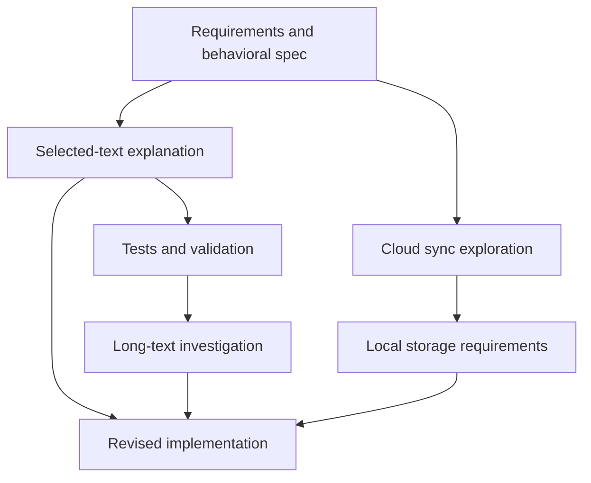

# Focus

**Keep your ideas moving. Let Focus organize the work.**

English · [简体中文](README.zh-CN.md)

Focus is an open-source, local-first agent workspace for building software as your ideas and requirements evolve. Keep sharing ideas, asking questions, and making decisions through **Patrol**. Patrol organizes the contexts behind your project and coordinates successive rounds of work.

**You → Patrol → A collection of contexts**

Start with a rough idea, refine the requirements and spec, move into implementation and validation, then adjust your decisions as results arrive. Clear requirements can move into development while open questions remain under exploration. You work through the same entry point throughout.

**Rough idea → Refined spec → Execution → Revised decisions → Further execution.**

[Quick start](#quick-start) · [Working strategies](#strategy-bring-your-way-of-working) · [Documentation](#documentation)

## One entry point for an evolving project

When a project keeps changing, organizing conversations becomes work of its own:

- Which conversation should receive this new idea?
- Do I need to stop an ongoing task before asking a question?
- A decision has changed. Which work needs to change, and which results still hold?
- How should a conclusion from one conversation inform the next implementation?

Focus gives that organizational work to Patrol. You express goals, feedback, and tradeoffs. Patrol considers the current state of the project and proposes what should continue, what needs independent exploration, which results should come together, and which plans need to change.

Behind this entry point are multiple **Contexts** that can evolve independently. Each Context holds the background, discussion, and results of a continuing line of work. Requirements, implementation, investigation, and validation can be at different stages while sharing relevant results with traceable sources.

**You can express the next thought without first choosing a thread or planning when to interrupt it.** An input is accepted first; a new Patrol decision determines how it affects the work. The interface distinguishes receipt of your input from its subsequent handling.

## Clarify the idea while building the software

Consider an Obsidian plugin. The following example shows a sequence of inputs you could give to the same Patrol.

### Begin before every requirement is settled

> I want a plugin that explains selected text. Work out the interaction, error cases, and acceptance criteria first. I haven't decided about cloud sync yet.

Requirements work can establish a concrete behavioral spec: how the feature starts, where results appear, how failures are handled, and what counts as completion. Open questions remain available for exploration.

### Move the clear parts forward

> The selected-text explanation feature is decided. Start building it. Keep evaluating cloud sync, but don't implement it yet.

Confirmed work can enter development while unresolved options remain under discussion. Work proceeds according to actual dependencies. When a missing decision needs your attention, Focus presents a specific request for input.

### Change a decision after seeing the results

> Drop cloud sync for now and use local storage. Keep the explanation feature that already works. Add support for long text and regression tests.

The new decision becomes an input to subsequent work. Patrol determines which plans are affected, which results remain useful, and how implementation and validation should proceed.

### Give feedback on the result in front of you

> This version freezes on long text. Investigate the cause first, preserve the existing interface, then fix it and verify the result.

Open a specific file version from an output record, add it as a reference, and describe the problem. Feedback can point to the exact result you have just reviewed.

As the project develops, contexts branch and come together where the work calls for it. This diagram illustrates the relationships between several lines of work:



The resulting context network records how the project was understood, implemented, and revised. An existing Context continues when it can support the next step; new contexts are derived when independent work or a different selection of background is useful.

## A loop modeled on how a person keeps work moving

Focus models a person working within one workspace: organizing several lines of work, responding to changing goals, and moving between discussion, action, and feedback.

Each round revisits the questions: **What should we do now? What has changed? Which work should continue? Which results support the next step?**

1. **Observe the current situation.** Bring together user input, task progress, contexts, and actual execution results.
2. **Organize the next work.** Continue, derive, or combine contexts, and determine what should proceed, change, or wait.
3. **Arrange execution.** Let Runs advance the relevant contexts, with concurrency or queueing based on dependencies, permissions, and available capacity.
4. **Reconsider with new results.** Use execution and validation outcomes in the next observation to refine requirements and plans.

You can keep submitting input while execution is underway. Ideas under discussion, confirmed decisions, reference material, and deferred items receive distinct treatment, with records of how they affect subsequent work.

## Inspect progress and step in when needed

Use Patrol for everyday input. Open the workbench when you want a closer look.

| View | What it shows |
| --- | --- |
| **Task Progress** | Verified, ongoing, blocked, or superseded work, with associated contexts and evidence status. |
| **Observation** | The user input, task state, and execution snapshot used for a particular round's decisions. |
| **LoopFact** | Incoming execution, test, file, and workspace-result facts, together with their sources. |
| **Context graph** | Relationships between lines of work, execution status, conversations, and historical versions. |

Open important file outputs and modifications to inspect saved content and available diffs. Use **@ file-version references** to give feedback on a specific result. Inspecting a Context keeps your everyday input directed to the same Patrol.

You can also pause, resume, or stop execution, adjust authorization and budgets, or open a line of work in the task interface to inspect, edit, and derive contexts directly.

### Patrol on your desktop

Windows includes a desktop robot entry point. Click it to open the input panel, drag it to reposition it, or drop screenshots, images, files, and reference text onto it. Preview the material, add your request, and send it. Restore the robot from the system tray after hiding it, or open the full workbench for details.

macOS uses the workbench window. Image input requires a configured model with image support.

Shell capabilities differ by platform. Windows supports read-only, workspace-write, and full-access execution. macOS currently supports full-access Shell only; restricted modes report that execution is unavailable and never relax permissions automatically. Users can approve full access for one call, or continue using file tools. Cancellation and timeouts on macOS stop the command's process group, then capture workspace file changes after exit is confirmed. Full access allows programs to leave that group, so it does not provide Windows Job-equivalent process-tree containment. macOS does not yet offer the full restricted coding experience.

The default code tools work without Shell access: `search_files` finds paths by glob, and `search_text` finds single-line literal text with paths, line/column numbers, and context. Both respect nested `.gitignore`, `.ignore`, and `.rgignore` rules, skip hidden entries by default, and do not follow directory links. `read_file_lines` returns numbered text pages with SHA-256 and continuation cursors. `edit_file` validates unique, non-overlapping old-text matches against the original file, commits replacements together, returns the actual diff, and records the file version. Pass `expected_sha256` to reject stale edits, then reread on a mismatch.

Line reads and edits support UTF-8 files up to 4 MiB. Pages default to 200 lines, with limits of 500 lines and 20000 content characters; long lines can continue by column. Searches default to 100 matching lines/paths, adjustable to 200, with scan and output limits. Results explicitly report `truncated`, `incomplete`, `limit_reasons`, and `skipped` when a search is partial. `read_file` retains complete material reading, and `write_file` handles new files or intentional whole-file writes.

## Strategy: bring your way of working

**A Strategy describes how a project should advance, how contexts should be organized, and what information subsequent work should inherit.**

For example: validate a critical assumption before implementation; investigate repeated failures before trying another approach; or explore alternatives independently and choose based on actual results.

Under **Memory → Strategy**, you can create, import, edit, and export a `STRATEGY.md`, with global or workspace scope. Keep using Patrol as usual, or explicitly request a method: “Use the validate-critical-assumptions-first strategy for this task.”

A Strategy has three parts:

| Part | Purpose |
| --- | --- |
| `applicability` | When the method is useful, and when it is unnecessary. |
| `evolution` | How work advances, adapts, comes together, and ends. |
| `inheritance` | Which background, evidence, and constraints each line of work should carry. |

Enabled strategies are available for Patrol to consider against the current task. Actual adoption is recorded with the round, and execution remains subject to current requirements, permissions, and budgets.

Read the [Strategy guide](docs/strategies/README.md), or start with the [validate critical assumptions](docs/strategies/examples/validate-before-build/STRATEGY.md) example.

## Quick start

Install a stable release with the one-line installer, or run Focus from source.

### Prerequisites

- Git.
- Python **3.11+**.
- Node.js **22.12.0+** and npm.
- Docker Desktop with Docker Compose, with Docker running.
- A working model-service account and API key, which you can configure after launch.

### One-line installation

These commands require a published, non-prerelease stable `vX.Y.Z` release with the corresponding installer attached. Before the first stable release is published, use the source instructions below.

**Windows · PowerShell**

```powershell
irm https://github.com/Leeminjing/Focus/releases/latest/download/install.ps1 | iex
```

**macOS · Terminal**

```bash
curl -fsSL https://github.com/Leeminjing/Focus/releases/latest/download/install.sh | sh
```

After installation, open a new terminal and run:

```sh
focus
```

To update, first close Focus and keep Docker Desktop running, then execute:

```sh
focus update
```

See [stable releases, installation, and update recovery](docs/managed-releases.md) for details.

To inspect a running instance or export a diagnostic report:

```sh
focus doctor
focus doctor --output focus-diagnostics.json
```

The report includes version and schema checks, live component health, Loop/Run IDs,
queue backlog, budget usage, recent event identities and startup timings. With Focus
stopped, it performs read-only offline checks. See [diagnostics](docs/diagnostics.md)
for source usage and exit codes.

Managed installs keep application code in `~/.focus/app`, dependencies and CLI
entry points in `~/.focus/runtime`, and the terminal command in `~/.focus/bin`.

### Run from source

On the first launch from source, the desktop app checks the runtime, starts local PostgreSQL if needed, applies database migrations, and starts the backend service.

#### Windows · PowerShell

```powershell
git clone https://github.com/Leeminjing/Focus.git
cd Focus

py -3 -m venv .venv
.\.venv\Scripts\python.exe -m pip install -r scripts/desktop-requirements.txt
.\.venv\Scripts\python.exe -m pip install --no-deps -e backend/packages/harness

$env:FOCUS_PYTHON = (Resolve-Path .\.venv\Scripts\python.exe).Path
npm --prefix desktop ci
npm --prefix desktop run install:electron
npm --prefix desktop start
```

#### macOS · Terminal

```bash
git clone https://github.com/Leeminjing/Focus.git
cd Focus

python3 -m venv .venv
.venv/bin/python -m pip install -r scripts/desktop-requirements.txt
.venv/bin/python -m pip install --no-deps -e backend/packages/harness

export FOCUS_PYTHON="$PWD/.venv/bin/python"
npm --prefix desktop ci
npm --prefix desktop run install:electron
npm --prefix desktop start
```

For later launches from source, run `npm --prefix desktop start` from the repository root. In a new terminal, first set `FOCUS_PYTHON` again as shown above so it points to the Python executable in this virtual environment.

### Configure a model and start a project

1. Open **Settings → Models**, enter a real API key, and check the model name, service URL, and API protocol.
2. Choose the default model and the curation default model. Both can use the same model entry.
3. Save and confirm that both the regular-call and curation-output checks pass.
4. Select a local folder as your workspace and send Patrol your first goal, question, or idea.

Focus provides OpenAI / DeepSeek configurations and model connections using Responses or compatible Chat Completions protocols. Validate your specific model and endpoint in Settings. User model preferences are saved in `~/.focus/config.yaml`; see [config.yaml](config.yaml) and [.env.example](.env.example) for file-based configuration.

Task state and contexts are stored in local PostgreSQL by default. Model calls connect to your configured service and send the content needed for that request.

## Skills, MCP, and memory

Equip Focus with methods and tools for individual tasks, and retain knowledge you want to reuse.

| Capability | Purpose |
| --- | --- |
| **Skill** | Instructions and methods for a specific kind of work. |
| **MCP** | External tools and services that the model can call. |
| **Memory** | Reusable facts, decisions, and constraints. |
| **Strategy** | Methods for organizing contexts and advancing the overall project. |

Skills and MCP support global and workspace scopes:

| Configuration | Global location | Workspace location |
| --- | --- | --- |
| Custom Skill | `~/.focus/.agents/skills/<name>/SKILL.md` | `<workspace>/.agents/skills/<name>/SKILL.md` |
| MCP | `~/.focus/extensions_config.json` | `<workspace>/.focus/extensions_config.json` |

Skills with the same name resolve in **workspace → global → built-in** priority order. MCP configuration is merged in **application defaults → global → workspace** order. Changes apply to subsequent assembly; active Runs retain their assembled tools and explicitly selected Skill snapshots.

Focus includes [`focus-skill-to-strategy`](skills/public/focus-skill-to-strategy/SKILL.md) by default. Type `/` in the composer to select it, provide a source `SKILL.md`, and ask to migrate it. The skill converts methods for organizing contexts and inheriting evidence into a Strategy while preserving execution instructions in the original Skill. Preview and install the generated `STRATEGY.md` through **Memory → Strategy → Import strategy**. To disable the built-in version, set `skills.focus-skill-to-strategy.enabled` to `false` in the global or workspace `extensions_config.json`.

The “No workspace” mode also lets you select a global or specific-workspace assembly target and configure capabilities in its corresponding conversation.

## How it works

| Object | Responsibility |
| --- | --- |
| **Patrol** | Receives user intent, observes the overall situation, and proposes the next arrangement of work. |
| **Context** | Holds the background and results of a continuing line of work, with immutable Revisions recording versions and sources. |
| **Run** | One actual execution based on a Context. |
| **Round** | A frozen observation, a decision, and the associated execution, retaining the inputs and evidence used at the time. |
| **Kernel** | Validates permissions, versions, and state before committing a decision into executable work. |

Contexts can persist over time or be derived from multiple sources. Execution results return to the overall project state and inform subsequent arrangements.

Concurrent writing tasks require authorized Git worktree isolation and a clean baseline. When those conditions are unavailable, work proceeds serially within available resources. Execution respects authorization and budgets, with explicit requests when user input or approval is needed.

Completion uses evidence from an independent verification process, checked against the current task, contexts, and workspace. Test, file, and tool results support the acceptance checks.

### Stack and source map

Python · LangChain / LangGraph · FastAPI · PostgreSQL · Electron · JavaScript

| Directory | Contents |
| --- | --- |
| [backend/app/desktop/agent_loop](backend/app/desktop/agent_loop/) | Patrol, rounds, task progress, execution coordination, and completion checks. |
| [backend/app/desktop/context_evolution](backend/app/desktop/context_evolution/) | Context versions, source relationships, and the evolution graph. |
| [backend/app/desktop/workspace_coordination](backend/app/desktop/workspace_coordination/) | Workspace access, isolation, and result adoption. |
| [backend/packages/harness/focus](backend/packages/harness/focus/) | Agent runtime, models, tools, Skills, MCP, and persistence. |
| [desktop](desktop/) | Desktop shell, robot entry point, and workbench. |

## Documentation

- [Strategy: write, import, and share working methods](docs/strategies/README.md)
- [File outputs and version-specific feedback](docs/context-evolution-file-feedback.md)
- [Task progress, round memory, and source relationships](docs/round-memory-architecture.md)
- [Concurrent execution with Git worktrees](docs/governed-worktree-parallel-runs.md)
- [Desktop startup](docs/desktop-startup.md)
- [Context browsers on Windows: usage, Agent tools and validation](docs/distinct-browser.md)
- [Stable releases, installation, and update recovery](docs/managed-releases.md)
- [First-run and live-model acceptance](docs/first-run-acceptance.md)

## Contributing

Use [Issues](https://github.com/Leeminjing/Focus/issues) to report problems and reproducible examples, or contribute through a Pull Request. Include your operating system, model and protocol, reproduction steps, and observed result when reporting an issue.

## License

[Apache License 2.0](LICENSE)
