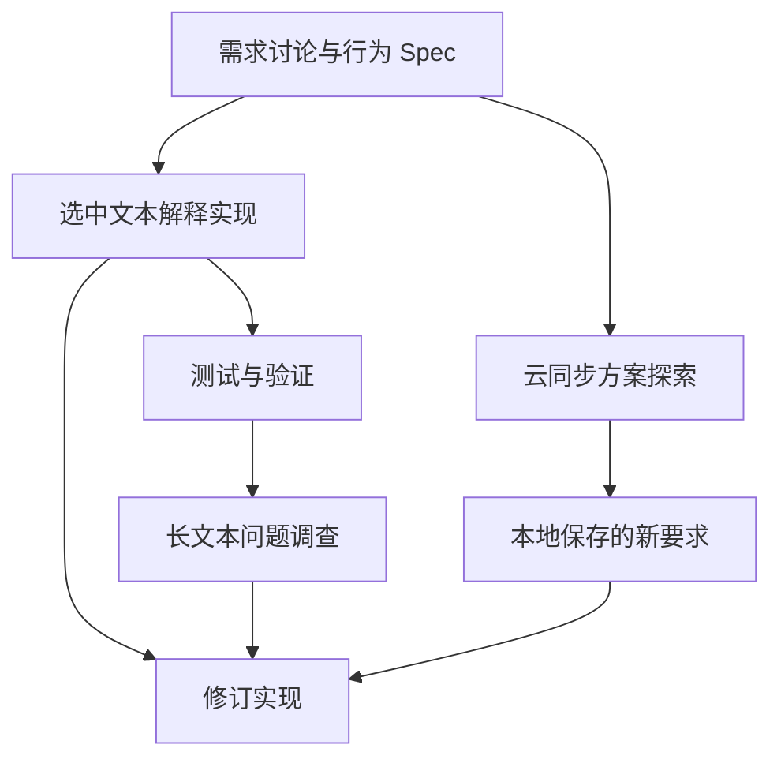

# Focus

**不用管理线程，让想法持续变成软件。**

[English](README.md) · 简体中文

Focus 是一个开源、本地优先的 Agent 开发工作区。你持续向 **Patrol** 表达想法、提出问题、作出决定；Patrol 组织背后的上下文集合，安排一轮轮工作，让项目在需求不断变化的过程中持续推进。

**用户 → Patrol → 上下文集合**

从一个模糊想法开始，逐渐明确需求与 Spec，进入实现和验证，再根据结果调整决定、继续执行。已明确的部分可以先开发，尚未确定的部分可以继续探索。你始终通过同一个入口推进整个项目。

**模糊想法 → 精细化 Spec → 执行 → 调整决策 → 继续执行。**

[快速开始](#快速开始) · [工作策略](#strategy把你的工作方法交给-focus) · [文档](#文档)

## 一个入口，持续组织整个项目

做一个不断变化的项目时，组织会话本身就会消耗注意力：

- 这个新想法应该放在哪条会话？
- 开发还在进行，现在问个问题要不要先点停止？
- 某个方案变了，哪些工作需要调整，哪些成果可以保留？
- 另一条会话里的结论，该怎样带到接下来的实现中？

Focus 把这部分组织工作交给 Patrol。你表达目标、反馈和取舍，Patrol 根据当前进展判断：继续已有工作、开启独立探索、汇合相关结果，或调整已经失去意义的安排。

一个入口后面，保留着多条可以独立演化的 **Context**。每个 Context 保存一条工作线需要的背景、讨论和结果；需求探索、功能实现、失败调查与验证可以处于不同阶段，并在需要时共享有来源的成果。

**你不必先选好线程、安排好打断时机，再表达下一句话。** 输入先被受理，再由 Patrol 的新决策确定如何影响工作；界面中的“已受理”表示输入已经收到，具体处理结果可以继续查看。

## 一边把需求想清楚，一边把软件做出来

以开发一个 Obsidian 插件为例，下面是一组可以持续交给 Patrol 的输入。

### 从还没想完整的需求开始

> 我想做一个选中文本就能解释的插件。先把交互、异常情况和验收标准梳理清楚，云同步我还没想好。

需求讨论可以先形成明确的行为 Spec：什么时候触发、如何显示结果、失败时如何处理、怎样验收。尚未确定的问题保留为探索事项。

### 让已明确的部分先向前走

> 选中文本解释已经确定，先做出来。云同步继续评估，先别进入实现。

已确认的功能进入开发，待定方案继续讨论。工作线按照实际依赖推进；遇到需要用户决定的缺口时，Focus 会展示具体的补充请求。

### 看到结果后，继续改变决定

> 云同步先不要了，改为本地保存。已经可用的解释功能保留，补上长文本处理和回归测试。

新决定成为后续工作的依据。Patrol 判断哪些安排受到影响，哪些成果可以继续使用，再组织实现与验证。

### 针对眼前的结果继续反馈

> 这个版本处理长文本时会卡住。先定位原因，保留现有接口，再修复并验证。

在文件产出记录中打开具体版本，将它加入输入引用，再描述问题。反馈可以指向刚刚看到的那一版结果。

在这样的过程中，上下文会随工作需要分化与汇合。下面示意一组工作线之间的来源关系：



这张逐渐形成的上下文网络，记录项目怎样被想清楚、实现和修正。已有 Context 足以承接下一步时，就继续使用；需要独立讨论或重新组织背景时，再派生新的工作线。

## 拟人 Loop：任务在变，工作持续向前

Focus 的 Loop 模拟一个人在同一工作区中，面对持续变化的目标，不断组织多条工作线，在讨论、执行和反馈之间推进项目。

每一轮都会重新考虑：**现在要做什么？哪些要求改变了？哪些工作继续？哪些结果足以支持下一步？**

1. **观察当前局面**：结合用户输入、任务进度、上下文和真实执行结果。
2. **组织下一步工作**：复用、派生或汇合 Context，明确继续、调整和等待的事项。
3. **安排执行**：让 Run 在相应 Context 中推进工作，根据依赖、权限和可用容量安排并行或排队。
4. **带着结果重新判断**：将执行与验证结果纳入后续观察，继续细化要求和调整安排。

用户可以在执行期间继续输入。讨论中的想法、已确认的决定、参考材料和暂缓事项会被分别处理，并保留它们与后续工作的关系。

## 随时查看进展，也能直接介入

日常通过 Patrol 表达；需要了解细节时，再展开工作台。

| 视图 | 你可以看到什么 |
| --- | --- |
| **Task Progress · 任务进度** | 已验证、正在推进、被阻塞或被替代的事项，以及相关工作线和证据状态。 |
| **Observation · 本轮观察** | 本轮决策所依据的用户输入、任务状态与运行快照。 |
| **LoopFact · 事实流** | 持续产生的执行、测试、文件产出和工作区结果，以及它们的来源。 |
| **上下文图谱** | 工作线之间的来源关系、运行状态、会话内容和历史版本。 |

重要文件产出与修改可以直接点开，查看已保存的内容和可用的 Diff，并通过 **@ 引用文件版本** 继续提出意见。查看某个 Context 时，日常输入仍面向同一个 Patrol。

你也可以暂停、继续或停止执行，调整授权与预算，或在任务界面打开某条工作线，直接查看、编辑和派生上下文。

### 把 Patrol 放在桌面上

Windows 提供桌面机器人入口：点击展开输入面板，拖动调整位置，把截图、图片、文件或参考文字拖入，预览后补充要求并发送。隐藏后可以从托盘重新唤出，需要细节时进入完整工作台。

macOS 使用工作台窗口。图片输入需要配置支持图像的模型。

Shell 的平台能力有差异：Windows 提供只读、工作区写入和完全访问三档执行；macOS 目前仅提供完全访问 Shell，受限模式会明确返回不可用，不会自动放宽权限。需要执行时，可由用户单次批准完全访问，或继续使用文件工具。macOS 的取消与超时会停止本次进程组，确认退出后采集工作区文件变化；完全访问不限制程序主动脱离进程组，因此不提供 Windows Job 等价的进程树隔离保证。macOS 尚不具备完整的受限编程体验。

默认代码工具无需 Shell 权限：`search_files` 按 glob 定位文件，`search_text` 搜索单行字面文本并返回路径、行列与上下文；两者遵守分层 `.gitignore`、`.ignore`、`.rgignore`，默认跳过隐藏项且不跟随目录链接。`read_file_lines` 返回带行号、SHA-256 与续读游标的文本页。`edit_file` 在原文件中校验一组唯一、不重叠的旧内容，再一次提交替换，返回实际 diff 并记录文件版本；可通过 `expected_sha256` 拒绝过期编辑，失败后应重读。

行读取与编辑仅支持最多 4 MiB 的 UTF-8 文件；每页默认 200 行，最多 500 行及 20000 个内容字符，超长行可按列续读。搜索默认最多 100 个匹配行/路径，可调至 200，同时限制扫描量与输出；返回的 `truncated`、`incomplete`、`limit_reasons`、`skipped` 会明确说明未完整搜索的情况。`read_file` 保留完整材料读取接口，`write_file` 用于新建或有意整文件写入。

## Strategy：把你的工作方法交给 Focus

**Strategy 定义项目怎样推进、上下文怎样组织，以及后续工作应当继承哪些信息。**

例如：先验证关键假设再实现；遇到反复失败时先调查原因；独立比较多个方案，再根据真实结果作出选择。

在 **记忆库 → Strategy · 工作策略** 中，可以新建、导入、编辑和导出 `STRATEGY.md`，选择全局或工作区范围。日常仍然直接向 Patrol 表达，也可以明确说：“这次按先验证关键假设的方法推进。”

一份 Strategy 包含三个部分：

| 部分 | 作用 |
| --- | --- |
| `applicability` | 什么情况下适用，什么时候无需采用。 |
| `evolution` | 如何推进、调整、汇合和结束工作。 |
| `inheritance` | 各条工作线继承什么背景、证据和约束。 |

启用的策略供 Patrol 根据当前任务选择；实际采用会随轮次记录，执行仍遵守当前要求、权限和预算。

阅读 [Strategy 文档](docs/strategies/README.md)，或从 [先验证关键假设](docs/strategies/examples/validate-before-build/STRATEGY.md) 示例开始。

## 快速开始

可以通过一键安装脚本安装跟随 GitHub main 的开发版或正式 Release 稳定版，也可以从源码运行 Focus。

### 准备环境

- Git。
- Python **3.11+**。
- Node.js **22.12.0+** 与 npm。
- Docker Desktop，包含 Docker Compose，且 Docker 已启动。
- 一个可用的模型服务账号与 API Key，可在首次启动后配置。

### 一键安装

开发机使用 dev 通道。尚无正式 Release 时也可以安装：

**Windows · PowerShell**

```powershell
$previousFocusChannel = $env:FOCUS_CHANNEL
$env:FOCUS_CHANNEL = 'dev'
try { irm https://raw.githubusercontent.com/Leeminjing/Focus/main/install.ps1 | iex }
finally { $env:FOCUS_CHANNEL = $previousFocusChannel }
```

**macOS · Terminal**

```bash
curl -fsSL https://raw.githubusercontent.com/Leeminjing/Focus/main/install.sh | sh -s -- --dev
```

下列稳定版安装命令要求存在已发布、非预发布的 `vX.Y.Z` Release，且附带两个安装脚本。全新安装默认 stable；重跑安装器默认沿用已有通道。显式切换可使用本地安装脚本的 `-Stable` / `--stable`，或 `FOCUS_CHANNEL=stable`。

**Windows · PowerShell**

```powershell
irm https://github.com/Leeminjing/Focus/releases/latest/download/install.ps1 | iex
```

**macOS · Terminal**

```bash
curl -fsSL https://github.com/Leeminjing/Focus/releases/latest/download/install.sh | sh
```

安装完成后，打开一个新终端，运行：

```sh
focus
```

更新时，先关闭 Focus，并保持 Docker Desktop 运行，再执行：

```sh
focus update
focus update --dev
focus update --stable
```

`focus update` 沿用当前安装通道；`--dev` 跟随 main，`--stable` 跟随最新正式 Release。两者都执行完整备份、迁移、健康检查与失败恢复，验收成功后才切换通道。没有正式 Release 时，stable 会报错。

旧安装需要先关闭 Focus、保持 Docker 运行，重新执行上方开发版安装命令一次。它会迁移仓库外的 `~/.focus/runtime/cli`；仅更新 `~/.focus/app` 无法刷新旧命令逻辑。已有配置、数据库和历史保留。

查看健康摘要或导出统一故障诊断报告：

```sh
focus doctor
focus doctor --output focus-diagnostics.json
```

报告包含版本、schema、实时组件状态、Loop/Run 关联 ID、队列积压、预算用量、近期事件标识和启动耗时。
Focus 未启动时执行只读离线检查。源码运行方式与退出码见[故障诊断说明](docs/diagnostics.md)。

托管安装将应用代码放在 `~/.focus/app`，依赖与命令入口放在 `~/.focus/runtime`，终端命令放在 `~/.focus/bin`。

安装与更新流程详见 [稳定版发布、安装与更新恢复](docs/managed-releases.md)。

### 源码运行

首次从源码启动时，桌面应用会检查运行环境、按需启动本地 PostgreSQL、应用数据库迁移并启动后端服务。

#### Windows · PowerShell

```powershell
git clone https://github.com/Leeminjing/Focus.git
cd Focus

py -3 -m venv .venv
.\.venv\Scripts\python.exe -m pip install -r scripts/desktop-requirements.txt
.\.venv\Scripts\python.exe -m pip install --no-deps -e backend/packages/harness

$env:FOCUS_PYTHON = (Resolve-Path .\.venv\Scripts\python.exe).Path
npm --prefix desktop ci
npm --prefix desktop run install:electron
npm --prefix desktop start
```

#### macOS · Terminal

```bash
git clone https://github.com/Leeminjing/Focus.git
cd Focus

python3 -m venv .venv
.venv/bin/python -m pip install -r scripts/desktop-requirements.txt
.venv/bin/python -m pip install --no-deps -e backend/packages/harness

export FOCUS_PYTHON="$PWD/.venv/bin/python"
npm --prefix desktop ci
npm --prefix desktop run install:electron
npm --prefix desktop start
```

通过源码运行时，后续在仓库根目录执行 `npm --prefix desktop start`。换用新终端时，先按上述方式重新设置 `FOCUS_PYTHON`，指向该虚拟环境中的 Python。

### 配置模型，开始第一个项目

1. 打开 **设置 → 模型**，填写真实 API Key，核对模型名称、服务地址和 API 协议。
2. 指定默认模型与策展默认模型；两者可以使用同一模型。
3. 保存后，确认普通调用与策展输出两项验证通过。
4. 选择本地文件夹作为工作区，向 Patrol 发送第一个目标、问题或想法。

当前提供 OpenAI / DeepSeek 配置，以及 Responses 和兼容 Chat Completions 协议的模型接入；具体模型与端点需要通过设置页验证。用户模型偏好保存在 `~/.focus/config.yaml`。也可以通过 [config.yaml](config.yaml) 与 [.env.example](.env.example) 了解文件配置。

默认使用本地 PostgreSQL 保存任务状态和上下文；模型调用连接你配置的服务，并向它发送本次调用所需的内容。

内置 `web_search` 与 `web_fetch` 使用 [DeepSeek Search / Fetch](https://api-docs.deepseek.com/guides/search/)。在 `config.yaml` 声明联网凭据；`~/.focus/config.yaml` 中的同名配置优先：

```yaml
web_tools:
  api_key: $DEEPSEEK_API_KEY
```

将引用变量的实际值写入 `~/.focus/.env` 或进程环境变量后重启 Focus；进程环境变量优先。该字段也支持直接填写密钥。如果现有 DeepSeek 模型密钥已存于 `OPENAI_API_KEY`，可显式设置 `web_tools.api_key: $OPENAI_API_KEY` 复用它；工具始终使用此处声明的凭据，不受所选模型影响。省略整个配置段时默认引用 `$DEEPSEEK_API_KEY`，缺少凭据仅在调用联网工具时返回可恢复错误。查询最长 128 个 Unicode 字符，结果数保持 1～10 条；抓取的 Markdown 正文最多返回 30,000 字符。

## Skill、MCP 与记忆

Focus 可以装配具体工作所需的技能与工具，并保存可复用的项目知识。

| 能力 | 用途 |
| --- | --- |
| **Skill** | 为某项具体工作提供操作方法和说明。 |
| **MCP** | 接入模型可以调用的外部工具与服务。 |
| **Memory** | 保存需要复用的事实、决定与约束。 |
| **Strategy** | 描述整体工作的推进方式和上下文组织方法。 |

Skill 与 MCP 支持全局和工作区范围：

| 配置 | 全局位置 | 工作区位置 |
| --- | --- | --- |
| 自定义 Skill | `~/.focus/.agents/skills/<name>/SKILL.md` | `<工作区>/.agents/skills/<name>/SKILL.md` |
| MCP | `~/.focus/extensions_config.json` | `<工作区>/.focus/extensions_config.json` |

同名 Skill 按 **工作区 → 全局 → 内置** 的优先级解析；MCP 配置按 **程序默认 → 全局 → 工作区** 逐层合并。配置变更用于后续装配，正在执行的 Run 保留已装配的工具与手选 Skill 快照。

Focus 默认提供内置 Skill [`focus-skill-to-strategy`](skills/public/focus-skill-to-strategy/SKILL.md)。在输入框输入 `/` 选择它，提供源 `SKILL.md` 并要求迁移，即可把跨 Context 的工作组织与证据继承方法转换为 Strategy，纯执行方法继续保留在原 Skill 中。生成的 `STRATEGY.md` 可在 **记忆库 → Strategy → 导入策略** 中预览并安装。可在全局或工作区的 `extensions_config.json` 中设置 `skills.focus-skill-to-strategy.enabled: false` 停用内置版本。

在“无工作区模式”中，也可以选择全局或指定工作区作为装配目标，并在对应会话中配置相关能力。

## 工作原理

| 对象 | 职责 |
| --- | --- |
| **Patrol** | 承接用户意图，观察整个工作局面，提出下一步安排。 |
| **Context** | 持续保存一条工作线的背景与成果；通过不可变 Revision 记录版本和来源。 |
| **Run** | 基于某个 Context 的一次实际执行。 |
| **Round** | 一轮冻结观察、决策和相应执行，保留当时的输入与依据。 |
| **Kernel** | 校验权限、版本和状态，把有效决策提交为可执行安排。 |

Context 可以长期延续，也可以从多个来源派生。执行结果回到整体工作局面，再影响后续安排。

多个写入任务并行执行需要已授权的 Git worktree 隔离与干净基线；条件不足时按可用资源串行推进。执行受授权和预算约束，需要用户补充信息或批准时会明确呈现。

完成检查由独立验证流程提供证据，并经过当前任务、上下文和工作区状态校验。测试、文件与工具结果为验收提供依据。

### 技术栈与源码入口

Python · LangChain / LangGraph · FastAPI · PostgreSQL · Electron · JavaScript

| 目录 | 内容 |
| --- | --- |
| [backend/app/desktop/patrol/agent_loop](backend/app/desktop/patrol/agent_loop/) | Patrol、轮次、任务进度、执行协调与完成检查。 |
| [backend/app/desktop/contexts/evolution](backend/app/desktop/contexts/evolution/) | Context 版本、来源关系与演化图谱。 |
| [backend/app/desktop/workspaces/coordination](backend/app/desktop/workspaces/coordination/) | 工作区访问、隔离与结果采用。 |
| [backend/packages/harness/focus](backend/packages/harness/focus/) | Agent 运行时、模型、工具、Skill、MCP 与持久化。 |
| [desktop](desktop/) | 桌面壳、机器人入口与工作台。 |

## 文档

- [Strategy：编写、导入与分享工作方法](docs/strategies/README.md)
- [文件产出与版本反馈](docs/context-evolution-file-feedback.md)
- [任务进度、轮次记忆与来源关系](docs/round-memory-architecture.md)
- [Git worktree 并行执行](docs/governed-worktree-parallel-runs.md)
- [桌面启动流程](docs/desktop-startup.md)
- [Context 独立浏览器：使用、Agent 工具与验收](docs/distinct-browser.md)
- [稳定版发布、安装与更新恢复](docs/managed-releases.md)
- [首次运行与真实模型验收](docs/first-run-acceptance.md)

## 参与项目

欢迎通过 [Issues](https://github.com/Leeminjing/Focus/issues) 反馈使用问题、提交可复现的案例，或通过 Pull Request 参与开发。问题报告中请说明操作系统、使用的模型与协议、复现步骤和实际结果。

## 许可证

[Apache License 2.0](LICENSE)
