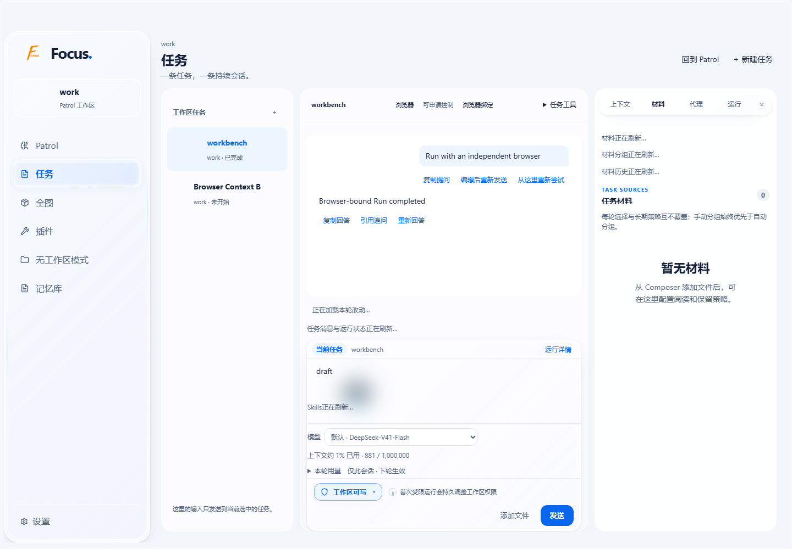
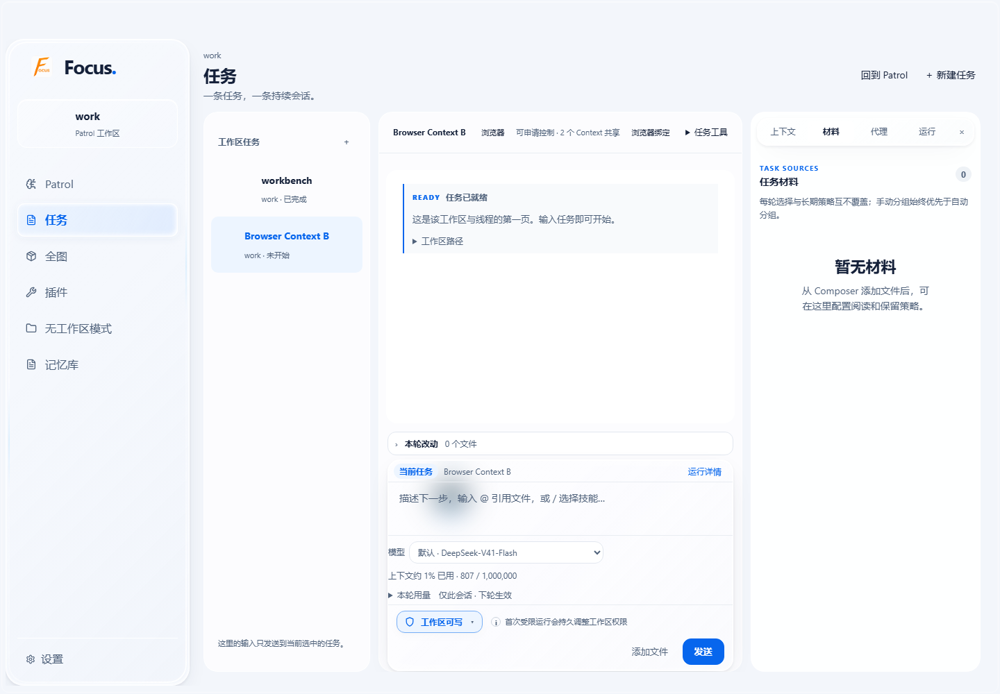

# Context 原生浏览器接入验收 · 2026-10-24

Focus 基线：`91cb69b27d029f4cc018912bbc30f568ca60d1f5`。
浏览器仓库 main 与已复核版本均为 `8eea976de275a657138c73815e4b2abf174c0f67`，
本次逐项阅读了该版本源码、`docs/protocol.md` 和 `docs/design.md`。
实现只位于 Focus，依赖方向为 Focus → focus-distinct-browser。

在当前 Windows 主机上，从固定源码调用上游构建脚本，控制状态机测试通过；
生成并随 Focus 携带的 EXE SHA-256 为：

```text
ff670d36d4810ab03c338045bf3080ae52ef838fbd76030975d35c2a51f05002
```

## 约定行为的实际验收

| 场景 | 实际执行与结果 |
| --- | --- |
| 独立并行 | 两个持久 Context 通过 Focus 创建不同原生窗口；并行导航、中文输入和点击；本地网页 POST 回报实际 DOM 结果，Cookie/localStorage 相互隔离；通过 |
| 原页面展示 | `present` 返回原 browser_id；保持原 URL、输入及租约；A 等待慢导航时 B 可及时展示；真实 Focus 任务列表点击调用同一展示接口；通过 |
| 明确共享 | 同工作区 Context 使用相同 browser_id 和页面；第二个观察等待 Focus 持有者释放后取得新令牌/观察；旧观察拒绝；解除一个共享者不会关闭仍被引用的窗口；通过 |
| 人工交接 | 调用原生按钮真实 WM_COMMAND 处理器，接管使旧令牌/观察失效；交还后必须重新观察；真实最小化和隐藏均暂停，present 恢复窗口后仍处于 paused；UI SSE 跟随原生交还变化；通过 |
| Run 生命周期 | Run 成功、取消后保留原页面；后续 Run 复用；持有控制权超过测试用 1 秒 TTL 后仍可观察，证明真实续租生效；取消释放控制；通过 |
| 关闭和断连 | 原窗口关闭会立即使等待模型的 Run 进入 error；断连也立即使活跃 Run 失败、令牌失效，并保留原窗口供人工使用；旧绑定及后端新实例拒绝静默重建；显式替换使用新连接/新 ID；通过 |
| Agent 实际调用 | 真实 LangGraph Agent 调用 observe、navigate、click、type、key、scroll、release；本地网页回报实际文字和点击次数，展示的就是该 browser_id；通过 |
| 完整生产链路 | 只替换 FocusResponsesChatModel 采样输出，保留生产 Agent 工厂、工具目录、访问策略、ToolExecutionLedger、typed history、PostgreSQL checkpoint、durable dispatch 和统一 Run 收尾；8 次工具调用成功，原生页面回报输入和点击，Run success 且页面保留；通过 |
| 状态与失败语义 | 创建等待期间耐久 Run 保持 pending，失败后直接 failed_to_start/error，数据库 running_at 为空且不创建内存执行或模型采样；worker 创建失败也不发布 running；响应乱序、交错事件及 UTF-8 中文关联正确；`result_unknown` 原样进入 error ToolMessage 且无重放；快速 Context 选择的迟到请求不会覆盖新选择；通过 |
| UI 与绑定保护 | 生产 Focus HTML、真实 HTTP、会话鉴权、PostgreSQL 和 SSE；通过 UI 选择共享并展示“2 个 Context 共享”；通用 UI 保存不能伪造/擦除绑定；通过 |

Agent 测试使用受控模型采样，浏览器、工具执行、协议、网页结果和生产持久链路均真实执行。
本次没有调用外部模型服务，未把模拟文本回复当作浏览器业务成功证据。
UI 用 headless Chromium 加载生产页面；仅测试浏览器上下文允许 CSP 调试求值，生产 CSP 未放宽。

## 执行结果

- 最终后端验收与相关回归：**40 passed**。包括新增 11 项协议/资源/真实窗口/生产工具/UI 测试，
  以及既有统一 Run 编排、SSE、最终状态恢复、durable dispatch、Loop 启动清理和静态资源回归。
- 相关前端与产物检查：**101 passed**。
- 另行运行现有 Main Run 身份/权限回归：**3 passed**。
- 桌面全量 `npm test`：**805 passed、4 failed、2 skipped**，总计 811 项。
  四个失败均在未修改的 HEAD 隔离源码中复现：
  `f20-architecture-guard` 的旧脚本顺序断言、`f21-fluid-ui` 的旧导航宽度断言、
  `f22-premium-ui` 的旧导航顺序断言，以及 `desktop-patrol-ui` 的 55 秒子进程超时。
  它们不是本次新增回归；没有为本次接入删除或放宽这些测试。
- `git diff --check`、新增 Python 模块编译、前端语法和 EXE 摘要验证通过。

没有阻碍本次约定范围接入的问题；桌面旧基线的全绿问题独立存在。

## 复跑

仓库根目录 PowerShell：

```powershell
$env:PYTHONPATH = "$PWD/backend/packages/harness;$PWD"
$env:PYTHONUTF8 = '1'
$env:FOCUS_BROWSER_REAL = '1'
python -m pytest backend/tests/test_context_browser.py backend/tests/test_context_browser_real.py backend/tests/test_context_browser_ui.py -q
node --test desktop/src/renderer/features/context/context-browser.test.cjs desktop/tests/integration/browser-artifact.test.cjs
npm --prefix desktop run prepare:browser
```

真实用例使用项目现有隔离 PostgreSQL fixture，需要本地开发数据库可用。
UI 用例额外需要测试环境的 Python Playwright 与 Chromium；这是测试依赖，不是浏览器能力的用户运行前提。
原生测试可通过 `FOCUS_BROWSER_ARTIFACTS` 指定截图目录，未指定时写入 pytest 临时目录。

## 截图

[Context 浏览器入口](browser-context-view.png) · [绑定选择](browser-binding.png) ·
[共享 Context 状态](browser-shared-context.png) · [原生页面 A](run-A.png) · [原生页面 B](run-B.png)




