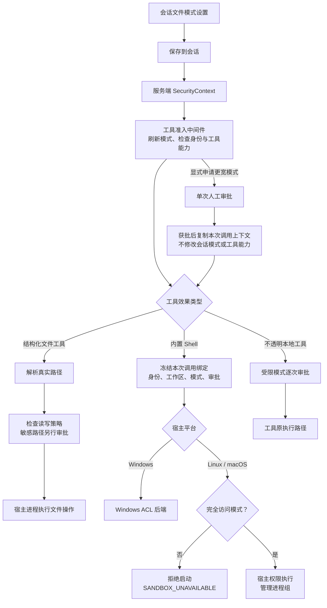
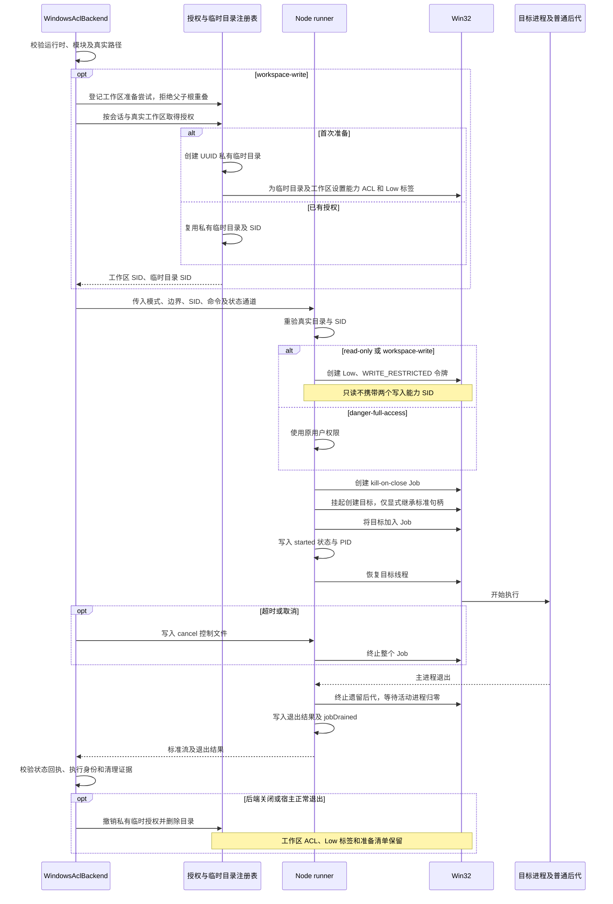

# 沙箱机制

[返回 README](../README.zh-CN.md) · [English README](../README.md)

Focus 使用工具准入、文件访问策略和平台 Shell 后端共同约束工具执行。文件模式分为 `read-only`、`workspace-write` 和 `danger-full-access`；工具能力授权与文件模式分别检查。

## 工具准入与执行路径

普通会话与 Patrol Loop 的工具调用都经过准入检查。Shell 启动时冻结本次调用的身份、工作区和模式；单次审批只改变该次调用的上下文。

- **结构化文件工具**：如 `read_file`、`discover_files`、`write_file`、`edit_file`，可以在执行前解析真实读写目标。敏感路径审批指这一层的逐路径检查；Shell 不会预先解析命令涉及的每个路径。
- **敏感路径**：Focus 明确保护的凭据、配置、技能、工具和插件位置，例如 `~/.focus/.env` 与工作区 `.agents/skills`。凭据读取需要审批，其他这些位置通常允许读取；写入先受文件模式限制，通过后还需业务审批。
- **不透明本地工具**：Focus 无法从认可的效果契约确定其本机副作用的工具，未声明效果的工具默认属于这一类。受限模式逐次审批，完全访问模式在文件模式这一层直接放行；获批后仍沿工具原执行路径运行。
- **POSIX 后端**：这里主要指 Linux / macOS。当前仅支持完全访问 Shell；受限模式在命令执行前返回 `SANDBOX_UNAVAILABLE`，文件工具仍可使用。系统不会自动放宽模式。

## Windows Shell 执行生命周期

Windows 受限执行由 Focus 自有 Node / Koffi 桥调用 Win32，通过目录 ACL、Low 完整性标签、逐调用受限令牌和 Windows Job 实施约束。Node runner 是每次 Shell 调用的管理进程，真正的命令由它启动的 CMD、PowerShell 等目标进程执行。

`cancel` 控制文件用于进程间通知：Python 后端写入取消或超时原因，runner 轮询发现后终止 Job。写入文件表示请求停止，`jobDrained` 回执才证明整个 Job 已清空。

私有临时目录按“会话 + 真实工作区”在后端实例内复用，正常退出时统一释放。结构化文件工具的可写根包含共享平台临时区，与 Shell 的私有临时目录不同；显式授权时还可加入全局 Focus 配置目录。

## 约束范围

- Windows 受限执行标记为 `partial`，不保证读取保密、网络隔离、进程隐藏、独立用户身份或虚拟机级隔离。
- NTFS 硬链接可能让工作区内外路径指向同一文件对象；结构化路径检查仍存在检查到使用之间的竞态。
- 工作区 ACL 和 Low 标签可能持久保留。强杀宿主不能依赖正常退出清理；恢复核验也不等于自动清扫旧临时目录或还原 ACL。
- 启动准备失败不会自动降级执行。清理证据为 `unknown` 时保留 Run 清理屏障，待可靠回执或系统重启证据核验后再结算。

## 源码入口

- [工具准入](../backend/packages/harness/focus/security/middleware.py)、[文件策略](../backend/packages/harness/focus/security/policy.py)、[敏感路径](../backend/packages/harness/focus/security/authority.py)
- [Windows 后端](../backend/packages/harness/focus/sandbox/windows.py)、[POSIX 后端](../backend/packages/harness/focus/sandbox/posix.py)
- [Node runner](../desktop/src/main/windows-sandbox-run.mjs)、[Win32 进程管理](../desktop/src/main/windows-sandbox/process.mjs)
- [私有临时目录](../backend/packages/harness/focus/sandbox/session_temp.py)、[清理证据恢复](../backend/packages/harness/focus/sandbox/recovery.py)
