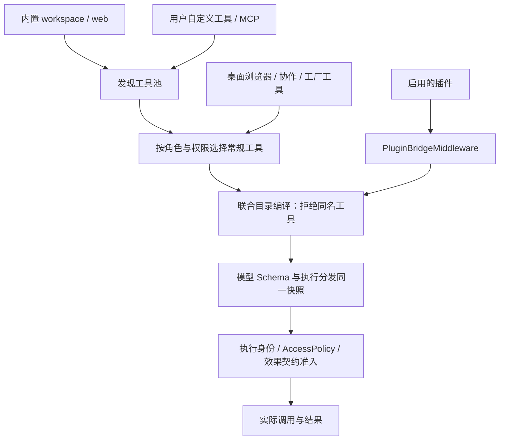

# Focus 工具图鉴

调查日期：2026-11-15。可静态枚举 **42 个模型工具**，另收录 **1 个内部编排工具、2 个内部远端适配条目**。这是源码覆盖清单，不表示任一 Run 同时拥有全部工具。MCP、自定义工具、用户插件和进程外插件为动态来源，数量未知，未并入静态总数。

源码依据：Git 提交 `5feed0d85284d145759baf7b5373ad80ee8edea3`。四个子 agent 分别调查内置工具、桌面与协作工具、插件、自定义/MCP 与装配架构；没有调用业务工具、连接外部 MCP 或读取用户私有配置。

工具调用示例是参数说明，不是执行记录。`runtime` 与服务端执行身份不属于模型可见参数；声明可见、图中绑定、执行获准是不同条件。

## 功能图鉴

按功能分表；子 Agent 工具按临时子 Agent、持久队友、持久工蜂分类。共享工具重复列出但不重复计数。点击工具名可查看完整参数、权限、输出、示例和源码。

### 文件与目录

按 read / write 权限装配。

| 工具 | 功能 | 主要参数 | 调用方／条件 |
| --- | --- | --- | --- |
| [`discover_files`](#discover_files) | 统一列目录、glob 找文件和字面文本搜索，无需 Shell。 | `path`、`pattern`、`query`、`recursive` | read |
| [`edit_file`](#edit_file) | 对现有 UTF-8 文件执行一次原子精确替换，可校验原文件版本。 | `path`、`edits`、`expected_sha256`、`requested_mode` | read + write |
| [`read_file`](#read_file) | 分页读取 UTF-8 文件或提取 PDF、DOCX、DOC 文档文本，可校验版本。 | `path`、`start_line`、`max_lines`、`start_column` | read |
| [`write_file`](#write_file) | 创建或覆盖 UTF-8 文本文件，自动创建父目录。 | `path`、`content`、`requested_mode`、`reason` | write |

### 命令执行

需要 host_command 权限和对应 Shell；执行仍受访问模式及沙箱约束。

| 工具 | 功能 | 主要参数 | 调用方／条件 |
| --- | --- | --- | --- |
| [`bash`](#bash) | 在本次运行工作区执行 Bash 命令。 | `command`、`requested_mode`、`reason` | host_command + 对应 Shell |
| [`cmd`](#cmd) | 在本次运行工作区执行 Windows CMD 命令。 | `command`、`requested_mode`、`reason` | host_command + 对应 Shell |
| [`powershell`](#powershell) | 在本次运行工作区执行 PowerShell 命令。 | `command`、`requested_mode`、`reason` | host_command + 对应 Shell |
| [`sh`](#sh) | 在本次运行工作区执行 POSIX sh 命令。 | `command`、`requested_mode`、`reason` | host_command + 对应 Shell |

### 网页搜索与抓取

使用 DeepSeek，需要有效凭据和网络。

| 工具 | 功能 | 主要参数 | 调用方／条件 |
| --- | --- | --- | --- |
| [`web_fetch`](#web_fetch) | 通过 DeepSeek 抓取单个网页，获取提取后的 Markdown 正文。 | `url` | DeepSeek 凭据与网络 |
| [`web_search`](#web_search) | 通过 DeepSeek 搜索网页，返回可引用的标题、完整 URL 与摘要。 | `query`、`max_results` | DeepSeek 凭据与网络 |

### 浏览器操作

需要 Windows 浏览器宿主和对应执行上下文；页面操作依赖有效观察。

| 工具 | 功能 | 主要参数 | 调用方／条件 |
| --- | --- | --- | --- |
| [`browser_click`](#browser_click) | 点击最近截图中的指定位置。 | `x`、`y`、`observation_id`、`coordinate_space` | Windows 浏览器执行上下文 |
| [`browser_close_page`](#browser_close_page) | 取得租约并关闭指定页面。 | `page_id` | Windows 浏览器执行上下文 |
| [`browser_key`](#browser_key) | 向当前页面发送指定键盘按键。 | `key`、`observation_id` | Windows 浏览器执行上下文 |
| [`browser_list_downloads`](#browser_list_downloads) | 只读检查下载进度、保存路径及完成或中断原因。 | 无 | Windows 浏览器执行上下文 |
| [`browser_list_pages`](#browser_list_pages) | 列出当前 Context 浏览器的所有真实页面。 | 无 | Windows 浏览器执行上下文 |
| [`browser_navigate`](#browser_navigate) | 依据有效观察导航当前真实页面。 | `url`、`observation_id` | Windows 浏览器执行上下文 |
| [`browser_observe`](#browser_observe) | 取得浏览器租约并查看当前真实页面截图。 | `page_id` | Windows 浏览器执行上下文 |
| [`browser_release`](#browser_release) | 释放浏览器租约，让共享 Context 接替操作。 | 无 | Windows 浏览器执行上下文 |
| [`browser_scroll`](#browser_scroll) | 在截图指定位置滚动页面。 | `x`、`y`、`delta_y`、`observation_id` | Windows 浏览器执行上下文 |
| [`browser_select_page`](#browser_select_page) | 取得浏览器级租约并切换到指定页面。 | `page_id` | Windows 浏览器执行上下文 |
| [`browser_type`](#browser_type) | 向当前页面已经聚焦的位置输入文字。 | `text`、`observation_id` | Windows 浏览器执行上下文 |

### 临时子 Agent · spawn_agent

一次性委派，等待完成后直接取得最终回答。

| 工具 | 功能 | 主要参数 | 调用方／条件 |
| --- | --- | --- | --- |
| [`spawn_agent`](#spawn_agent) | 同步等待一个临时子 Agent 独立处理任务，返回最终回答。 | `task`、`system_prompt` | 主 Agent（非受治理 Loop） |

### 持久队友 · teammate

持续负责一条工作线，可以通信、提交计划审批、申请停止，并被再次唤醒。

| 工具 | 功能 | 主要参数 | 调用方／条件 |
| --- | --- | --- | --- |
| [`spawn_teammate`](#spawn_teammate) | 后台创建持续存在的 Teammate，独立执行任务并发消息汇报。 | `task`、`system_prompt` | 主 Agent（非受治理 Loop） |
| [`wake_agent`](#wake_agent) | 唤醒已有 Teammate/Worker，并下达后续指令。 | `agent_id`、`message` | 主 Agent（非受治理 Loop） |
| [`wait_for_swarm`](#wait_for_swarm) | 有界等待持久 Agent 状态变化并查看协作快照。 | `agent_ids`、`timeout_seconds` | 主 Agent（非受治理 Loop）；1–30 秒 |
| [`read_swarm_agent_history`](#read_swarm_agent_history) | 读取当前任务指定 Teammate/Worker 已提交消息历史。 | `agent_id` | 主 Agent；Loop 中仍保留 |
| [`send_message`](#send_message) | 向指定 Agent 发消息，或广播给主 Agent 和全部协作 Agent。 | `to_agent`、`content`、`kind` | 主 Agent、队友、工蜂 |
| [`request_plan_approval`](#request_plan_approval) | Teammate 向主 Agent 提交计划审批请求。 | `plan` | 队友 |
| [`approve_plan`](#approve_plan) | 主 Agent 批准或拒绝某个 Agent 的计划。 | `agent_id`、`approved`、`feedback` | 主 Agent |
| [`request_shutdown`](#request_shutdown) | Teammate 请求主 Agent 批准停止其后续运行。 | `reason` | 队友 |
| [`respond_shutdown`](#respond_shutdown) | 主 Agent 批准或拒绝协作 Agent 的停机请求。 | `agent_id`、`approved` | 主 Agent |

### 持久工蜂 · worker

从任务板认领明确任务，执行后提交结果；也可以通信和被再次唤醒。

| 工具 | 功能 | 主要参数 | 调用方／条件 |
| --- | --- | --- | --- |
| [`spawn_worker`](#spawn_worker) | 后台创建持续存在的 Worker，用于认领并完成任务板任务。 | `task`、`system_prompt` | 主 Agent（非受治理 Loop） |
| [`wake_agent`](#wake_agent) | 唤醒已有 Teammate/Worker，并下达后续指令。 | `agent_id`、`message` | 主 Agent（非受治理 Loop） |
| [`wait_for_swarm`](#wait_for_swarm) | 有界等待持久 Agent 状态变化并查看协作快照。 | `agent_ids`、`timeout_seconds` | 主 Agent（非受治理 Loop）；1–30 秒 |
| [`read_swarm_agent_history`](#read_swarm_agent_history) | 读取当前任务指定 Teammate/Worker 已提交消息历史。 | `agent_id` | 主 Agent；Loop 中仍保留 |
| [`send_message`](#send_message) | 向指定 Agent 发消息，或广播给主 Agent 和全部协作 Agent。 | `to_agent`、`content`、`kind` | 主 Agent、队友、工蜂 |
| [`publish_task`](#publish_task) | 主 Agent 发布 pending 任务供 Worker 认领。 | `description`、`requirements` | 主 Agent |
| [`list_board_tasks`](#list_board_tasks) | 查看当前任务板全部任务的状态、认领者和结果。 | 无 | 主 Agent |
| [`claim_task`](#claim_task) | Worker 原子认领当前任务板中的 pending 条目。 | `board_task_id` | 工蜂 |
| [`complete_task`](#complete_task) | Worker 提交自己已认领任务的结果并标记完成。 | `board_task_id`、`result` | 认领该任务的工蜂 |

### 巡检小兵

查看用户投放的小兵及其已提交历史。

| 工具 | 功能 | 主要参数 | 调用方／条件 |
| --- | --- | --- | --- |
| [`list_patrol_agents`](#list_patrol_agents) | 查看当前任务中用户投放的小兵及最新提交状态。 | 无 | 主 Agent |
| [`read_patrol_agent_history`](#read_patrol_agent_history) | 读取当前任务指定小兵的已提交完整消息历史。 | `agent_id` | 主 Agent |

### 技能、图片与插件

各工具有独立的条件装配规则。

| 工具 | 功能 | 主要参数 | 调用方／条件 |
| --- | --- | --- | --- |
| [`describe_skill`](#describe_skill) | 按技能名称查询元数据和 SKILL.md 的真实宿主路径，支持懒发现。 | `name` | 主 Agent 等按条件装配 |
| [`report_must_view_images`](#report_must_view_images) | 逐图声明本轮必看图片是否已读，供完成门检查。 | `images` | 主 Agent 当前轮存在必看图片 |
| [`demo_echo`](#demo_echo) | 演示插件回声工具：将输入文本加上 demo-echo 前缀后返回，用于验证插件工具能够注入 Agent。 | `text` | 演示插件启用并加载成功 |

### 承诺流程中的模型工具

只在对应承诺阶段向模型提供。

| 工具 | 功能 | 主要参数 | 调用方／条件 |
| --- | --- | --- | --- |
| [`find_reference_urls`](#find_reference_urls) | 为用户明确引用但未提供完整 URL 的网站、文档或项目搜索最多 5 个候选网址。 | `query` | 承诺阶段 4 Worker |

### 内部编排与文档适配

由受控代码调用，不属于模型自由选择的工具目录；远端适配参数以真实 MCP schema 为准。

| 工具 | 功能 | 主要参数 | 调用方／条件 |
| --- | --- | --- | --- |
| [`delegate_with_review`](#delegate_with_review) | 执行承诺流程的一个阶段，经 Worker 产出与 Evaluator 审核后推进九阶段状态。 | `stage`、`instruction`、`context`、`acceptance_criteria` | 内部 ToolNode |
| [`query-docs`](#query-docs) | 承诺阶段 5 核实最新稳定版本，阶段 6查询已确认技术的官方理论资料。 | `libraryId`、`query` | 承诺阶段 5／6，Python 调用 |
| [`resolve-library-id`](#resolve-library-id) | 承诺阶段 5 将技术名称解析成 Context7 库标识。 | `libraryName`、`query` | 承诺阶段 5，Python 调用 |

## 工具怎样进入 Agent



完整的角色装配、MCP 信任边界和内部协议说明见 [架构调查](research/architecture.md)；插件与 ONLYOFFICE 边界见 [插件调查](research/plugin-notes.md)。


## 调用条件速览

- 工作区工具按 `read`、`write`、`host_command` 选择，并受 AccessMode 和效果契约准入约束；四个 Shell 是独立工具名。
- 浏览器、主代理协作、队友审批与工蜂任务板按角色装配；普通 Main、Context 执行和独立 Patrol 的工具组合不同。
- `describe_skill`、图片回执与临时子代理工具另有条件；插件桥仍可能向这些图贡献启用插件，不能把普通工具列表当成最终全集。
- `config.yaml` 的声明式 `tool_groups` 不再决定当前工具清单。动态 MCP 与 custom 的工具名、参数及可用性必须以实际 Run 的冻结目录为准。
- ONLYOFFICE HTTP/前端桥、插件 Hook、Patrol 的 `reads`/`decision` 等 JSON 协议能力不是独立 Agent tool。
- `no_local_effect` 仅描述本地文件系统效果，不表示没有联网、数据库写入、协作消息或浏览器状态变化。

## 逐项图鉴

### discover_files

**工作区 · 模型工具** — 统一列目录、glob 找文件和字面文本搜索，无需 Shell。

| 参数 | 类型 | 要求 | 默认值 | 含义 |
| --- | --- | --- | --- | --- |
| `path` | str | 可选 | "." | 路径；相对路径以本次运行工作区为基准，也接受绝对路径，最终由访问策略准入。 |
| `pattern` | str | 可选 | "*" | glob 路径过滤，1..512 字符。 |
| `query` | str \| None | 可选 | null | 单行字面搜索文本，1..2048 字符，非正则。 |
| `recursive` | bool | 可选 | true | 是否递归扫描。 |
| `include_directories` | bool | 可选 | false | 是否返回目录；提供 query 时不得为 true。 |
| `max_results` | int | 可选 | 100 | 最大文件或文本匹配结果数，范围 1..200，默认 100。 |
| `context_lines` | int | 可选 | 2 | 命中前后上下文行数，0..5。 |
| `case_sensitive` | bool | 可选 | true | 文本搜索是否大小写敏感。 |
| `include_hidden` | bool | 可选 | false | 是否包含隐藏项；.git 与目录链接仍跳过。 |

**返回：** JSON 字符串：path、matches（文件/目录路径，或文本命中的 line/column/上下文）、truncated、limit_reasons、skipped、incomplete、entries_scanned。

**启用条件：** 进入 WORKSPACE_TOOLS / 通用 builtin 池；桌面运行按 read 权限装配。

**效果与权限：** structured_fs：读取搜索树及适用的祖先忽略文件；需要 read 能力。

- 遵守 .gitignore/.ignore/.rgignore；默认跳过隐藏项，始终跳过 .git、目录链接。
- 单文件 4 MiB、累计读取 32 MiB、10000 扫描条目、5 秒、64 层深度、20000 输出字符均有限额。
- truncated/incomplete 代表搜索未完整，应缩小范围；query 是单行字面文本，不是正则。

```text
{
  "path": "backend",
  "pattern": "*.py",
  "query": "make_lead_agent",
  "max_results": 20
}
```

源码：[backend/packages/harness/focus/tools/builtins/workspace_tools.py:198](../../backend/packages/harness/focus/tools/builtins/workspace_tools.py#L198)

### edit_file

**工作区 · 模型工具** — 对现有 UTF-8 文件执行一次原子精确替换，可校验原文件版本。

| 参数 | 类型 | 要求 | 默认值 | 含义 |
| --- | --- | --- | --- | --- |
| `path` | str | 必填 | — | 路径；相对路径以本次运行工作区为基准，也接受绝对路径，最终由访问策略准入。 |
| `edits` | list[TextEdit] | 必填 | — | 1..50 个 TextEdit 对象；每项必须且只能含 old_text 和 new_text，二者均为严格字符串。old_text 非空、在原文件唯一匹配；new_text 可为空以删除旧内容。各替换区间不得重叠。 |
| `expected_sha256` | str \| None | 可选 | null | 预期原文件 SHA-256；不一致时拒绝继续。 |
| `requested_mode` | str \| None | 可选 | null | 可选单次模式升级申请；workspace-write 或 danger-full-access，必须比当前更宽并同时给非空 reason。已有能力仍不能凭此新增。 |
| `reason` | str \| None | 可选 | null | 单次模式升级的理由；requested_mode 非空时必须为非空。 |

**返回：** JSON 字符串：path、changed、before_sha256、sha256、diff、diff_truncated；实际 unified diff 最多 20000 字符。

**启用条件：** 进入 WORKSPACE_TOOLS / 通用 builtin 池；选择器按 write 装配，实际调用仍额外检查 read。

**效果与权限：** structured_fs：读取并写入同一 path；执行时同时需要 read/write；写入前后通知文件版本观察端口。

- edits 必须 1..50 项；old_text 非空且在原文件中唯一匹配，替换区间不得重叠。
- 保留 BOM、换行、空白原样；全部检查后一次提交。UTF-8 文件及更新后内容最多 4 MiB。
- 建议先 read_file，带回 sha256；版本变化、文本不匹配或路径变化时拒绝修改。

```text
{
  "path": "notes/example.txt",
  "edits": [
    {
      "old_text": "工具图鉴示例",
      "new_text": "Focus 工具图鉴示例"
    }
  ]
}
```

源码：[backend/packages/harness/focus/tools/builtins/workspace_tools.py:224](../../backend/packages/harness/focus/tools/builtins/workspace_tools.py#L224)

### read_file

**工作区 · 模型工具** — 分页读取 UTF-8 文件或提取 PDF、DOCX、DOC 文档文本，可校验版本。

| 参数 | 类型 | 要求 | 默认值 | 含义 |
| --- | --- | --- | --- | --- |
| `path` | str | 必填 | — | 路径；相对路径以本次运行工作区为基准，也接受绝对路径，最终由访问策略准入。 |
| `start_line` | int | 可选 | 1 | 起始行，从 1 开始。 |
| `max_lines` | int | 可选 | 200 | 请求行数，范围 1..500。 |
| `start_column` | int | 可选 | 1 | 起始列，从 1 开始；用于续读超长行。 |
| `expected_sha256` | str \| None | 可选 | null | 预期原文件 SHA-256；不一致时拒绝继续。 |
| `mode` | Literal['paged', 'full'] | 可选 | "paged" | paged 返回有界页；full 返回全文，不能同时更改分页参数。 |

**返回：** JSON 字符串。paged 含 path、sha256、format、utf8_bom、total_lines、lines[{line,column,text,line_ending}]、truncated、next_line、next_column；full 含 path、sha256、text、format。

**启用条件：** 进入 WORKSPACE_TOOLS / 通用 builtin 池；桌面运行按 read 权限装配。

**效果与权限：** structured_fs：读取指定 path；需要 read 能力，路径由 AccessPolicyMiddleware 准入。

- 默认每页 200 行，最多 500 行/20000 文本字符；分页 UTF-8 输入最多 4 MiB，full 不受该输入上限。
- 文档 SHA-256 绑定原文件字节；只有 utf-8 原文适合 edit_file 精确替换。
- 图片、二进制、无效 UTF-8、目录会返回可修正的错误；不做 OCR 或图像理解。
- runtime 由执行器注入，不是模型可填参数。

```text
{
  "path": "README.md",
  "max_lines": 80
}
```

源码：[backend/packages/harness/focus/tools/builtins/workspace_tools.py:148](../../backend/packages/harness/focus/tools/builtins/workspace_tools.py#L148)

### write_file

**工作区 · 模型工具** — 创建或覆盖 UTF-8 文本文件，自动创建父目录。

| 参数 | 类型 | 要求 | 默认值 | 含义 |
| --- | --- | --- | --- | --- |
| `path` | str | 必填 | — | 路径；相对路径以本次运行工作区为基准，也接受绝对路径，最终由访问策略准入。 |
| `content` | str | 必填 | — | 要整文件写入的 UTF-8 文本。 |
| `requested_mode` | str \| None | 可选 | null | 可选单次模式升级申请；workspace-write 或 danger-full-access，必须比当前更宽并同时给非空 reason。已有能力仍不能凭此新增。 |
| `reason` | str \| None | 可选 | null | 单次模式升级的理由；requested_mode 非空时必须为非空。 |

**返回：** 已写入真实宿主机路径: <absolute path>。

**启用条件：** 进入 WORKSPACE_TOOLS / 通用 builtin 池；桌面运行按 write 权限装配。

**效果与权限：** structured_fs：写指定 path；需要 write 能力；会覆盖现有内容，写入前后通知文件版本观察端口。

- 整文件覆盖，不提供 expected_sha256 竞争保护；局部变更应使用 edit_file。
- requested_mode/reason 由最外层中间件处理，工具体不自行放宽授权。

```text
{
  "path": "notes/example.txt",
  "content": "工具图鉴示例\n"
}
```

源码：[backend/packages/harness/focus/tools/builtins/workspace_tools.py:267](../../backend/packages/harness/focus/tools/builtins/workspace_tools.py#L267)

### bash

**代码执行 · 模型工具** — 在本次运行工作区执行 Bash 命令。

| 参数 | 类型 | 要求 | 默认值 | 含义 |
| --- | --- | --- | --- | --- |
| `command` | str | 必填 | — | 要交给所选 Shell 执行的非空命令。 |
| `requested_mode` | str \| None | 可选 | null | 可选单次模式升级申请；workspace-write 或 danger-full-access，必须比当前更宽并同时给非空 reason。已有能力仍不能凭此新增。 |
| `reason` | str \| None | 可选 | null | 单次模式升级的理由；requested_mode 非空时必须为非空。 |

**返回：** JSON 字符串，含 run/session/call/agent 标识、mode、workspace、mode_source、backend_applied、enforcement、status、exit_code、failure_kind、file_denial_observed、stdout/stderr/output、truncated、approval_id、cleanup_warnings、process_cleanup。

**启用条件：** 进入 WORKSPACE_TOOLS / 通用 builtin 池；桌面按 host_command 权限装配，还要求 PATH 中可找到对应 Shell。实际命令行：bash -c。

**效果与权限：** sandboxed_shell：需要 host_command 能力；命令可读写文件或执行外部程序，按本次服务端绑定的访问模式执行。

- Windows 使用 ACL 受限后端与可取消 Job，POSIX 完全访问使用进程组，POSIX 受限模式明确不可用。
- 拒绝 Windows WSL 启动器；找不到 Shell 或沙箱不可用时不启动替代命令。
- 输出合计超过 30000 字符时截断；stdout/stderr 分别保留末 15000 字符，output 保留末 30000 字符。
- requested_mode/reason 由准入中间件触发单次升级审核；不自动提升权限。
- process_cleanup 单列，清理告警不伪装为命令结果。

```text
{
  "command": "printf hello"
}
```

源码：[backend/packages/harness/focus/tools/builtins/workspace_tools.py:368](../../backend/packages/harness/focus/tools/builtins/workspace_tools.py#L368)

### cmd

**代码执行 · 模型工具** — 在本次运行工作区执行 Windows CMD 命令。

| 参数 | 类型 | 要求 | 默认值 | 含义 |
| --- | --- | --- | --- | --- |
| `command` | str | 必填 | — | 要交给所选 Shell 执行的非空命令。 |
| `requested_mode` | str \| None | 可选 | null | 可选单次模式升级申请；workspace-write 或 danger-full-access，必须比当前更宽并同时给非空 reason。已有能力仍不能凭此新增。 |
| `reason` | str \| None | 可选 | null | 单次模式升级的理由；requested_mode 非空时必须为非空。 |

**返回：** JSON 字符串，含 run/session/call/agent 标识、mode、workspace、mode_source、backend_applied、enforcement、status、exit_code、failure_kind、file_denial_observed、stdout/stderr/output、truncated、approval_id、cleanup_warnings、process_cleanup。

**启用条件：** 进入 WORKSPACE_TOOLS / 通用 builtin 池；桌面按 host_command 权限装配，还要求 PATH 中可找到对应 Shell。实际命令行：cmd.exe /c。

**效果与权限：** sandboxed_shell：需要 host_command 能力；命令可读写文件或执行外部程序，按本次服务端绑定的访问模式执行。

- Windows 使用 ACL 受限后端与可取消 Job，POSIX 完全访问使用进程组，POSIX 受限模式明确不可用。
- 拒绝 Windows WSL 启动器；找不到 Shell 或沙箱不可用时不启动替代命令。
- 输出合计超过 30000 字符时截断；stdout/stderr 分别保留末 15000 字符，output 保留末 30000 字符。
- requested_mode/reason 由准入中间件触发单次升级审核；不自动提升权限。
- process_cleanup 单列，清理告警不伪装为命令结果。

```text
{
  "command": "echo hello"
}
```

源码：[backend/packages/harness/focus/tools/builtins/workspace_tools.py:386](../../backend/packages/harness/focus/tools/builtins/workspace_tools.py#L386)

### powershell

**代码执行 · 模型工具** — 在本次运行工作区执行 PowerShell 命令。

| 参数 | 类型 | 要求 | 默认值 | 含义 |
| --- | --- | --- | --- | --- |
| `command` | str | 必填 | — | 要交给所选 Shell 执行的非空命令。 |
| `requested_mode` | str \| None | 可选 | null | 可选单次模式升级申请；workspace-write 或 danger-full-access，必须比当前更宽并同时给非空 reason。已有能力仍不能凭此新增。 |
| `reason` | str \| None | 可选 | null | 单次模式升级的理由；requested_mode 非空时必须为非空。 |

**返回：** JSON 字符串，含 run/session/call/agent 标识、mode、workspace、mode_source、backend_applied、enforcement、status、exit_code、failure_kind、file_denial_observed、stdout/stderr/output、truncated、approval_id、cleanup_warnings、process_cleanup。

**启用条件：** 进入 WORKSPACE_TOOLS / 通用 builtin 池；桌面按 host_command 权限装配，还要求 PATH 中可找到对应 Shell。实际命令行：powershell.exe -NoProfile -Command。

**效果与权限：** sandboxed_shell：需要 host_command 能力；命令可读写文件或执行外部程序，按本次服务端绑定的访问模式执行。

- Windows 使用 ACL 受限后端与可取消 Job，POSIX 完全访问使用进程组，POSIX 受限模式明确不可用。
- 拒绝 Windows WSL 启动器；找不到 Shell 或沙箱不可用时不启动替代命令。
- 输出合计超过 30000 字符时截断；stdout/stderr 分别保留末 15000 字符，output 保留末 30000 字符。
- requested_mode/reason 由准入中间件触发单次升级审核；不自动提升权限。
- process_cleanup 单列，清理告警不伪装为命令结果。

```text
{
  "command": "Get-Location"
}
```

源码：[backend/packages/harness/focus/tools/builtins/workspace_tools.py:395](../../backend/packages/harness/focus/tools/builtins/workspace_tools.py#L395)

### sh

**代码执行 · 模型工具** — 在本次运行工作区执行 POSIX sh 命令。

| 参数 | 类型 | 要求 | 默认值 | 含义 |
| --- | --- | --- | --- | --- |
| `command` | str | 必填 | — | 要交给所选 Shell 执行的非空命令。 |
| `requested_mode` | str \| None | 可选 | null | 可选单次模式升级申请；workspace-write 或 danger-full-access，必须比当前更宽并同时给非空 reason。已有能力仍不能凭此新增。 |
| `reason` | str \| None | 可选 | null | 单次模式升级的理由；requested_mode 非空时必须为非空。 |

**返回：** JSON 字符串，含 run/session/call/agent 标识、mode、workspace、mode_source、backend_applied、enforcement、status、exit_code、failure_kind、file_denial_observed、stdout/stderr/output、truncated、approval_id、cleanup_warnings、process_cleanup。

**启用条件：** 进入 WORKSPACE_TOOLS / 通用 builtin 池；桌面按 host_command 权限装配，还要求 PATH 中可找到对应 Shell。实际命令行：sh -c。

**效果与权限：** sandboxed_shell：需要 host_command 能力；命令可读写文件或执行外部程序，按本次服务端绑定的访问模式执行。

- Windows 使用 ACL 受限后端与可取消 Job，POSIX 完全访问使用进程组，POSIX 受限模式明确不可用。
- 拒绝 Windows WSL 启动器；找不到 Shell 或沙箱不可用时不启动替代命令。
- 输出合计超过 30000 字符时截断；stdout/stderr 分别保留末 15000 字符，output 保留末 30000 字符。
- requested_mode/reason 由准入中间件触发单次升级审核；不自动提升权限。
- process_cleanup 单列，清理告警不伪装为命令结果。

```text
{
  "command": "printf hello"
}
```

源码：[backend/packages/harness/focus/tools/builtins/workspace_tools.py:377](../../backend/packages/harness/focus/tools/builtins/workspace_tools.py#L377)

### web_fetch

**联网 · 模型工具** — 通过 DeepSeek 抓取单个网页，获取提取后的 Markdown 正文。

| 参数 | 类型 | 要求 | 默认值 | 含义 |
| --- | --- | --- | --- | --- |
| `url` | str | 必填 | — | 非空 http:// 或 https:// 网页 URL。 |

**返回：** Markdown 字符串，最多 30000 字符，超长时追加截断提示。

**启用条件：** 进入 WEB_TOOLS / 通用 builtin 池；桌面各 Agent 角色装配；运行时需配置可用 DeepSeek 凭据与网络。

**效果与权限：** no_local_effect：仅网络请求/内存文本；会向 DeepSeek 发送 URL。

- 只支持 http:// 与 https:// URL；不提供浏览器交互或页面脚本执行。
- 请求超时 30 秒；空正文、无效响应、鉴权或网络失败会报错。

```text
{
  "url": "https://docs.python.org/3/library/asyncio.html"
}
```

源码：[backend/packages/harness/focus/tools/builtins/web_tools.py:112](../../backend/packages/harness/focus/tools/builtins/web_tools.py#L112)

### web_search

**联网 · 模型工具** — 通过 DeepSeek 搜索网页，返回可引用的标题、完整 URL 与摘要。

| 参数 | 类型 | 要求 | 默认值 | 含义 |
| --- | --- | --- | --- | --- |
| `query` | str | 必填 | — | 搜索关键词；去空白后非空，最多 128 个 Unicode 字符。 |
| `max_results` | int | 可选 | 5 | 最大网页搜索结果数，范围 1..10，默认 5；必须为整数，不接受布尔值。 |

**返回：** 编号文本列表，每条为 [n] 标题、URL: 完整地址、摘要。

**启用条件：** 进入 WEB_TOOLS / 通用 builtin 池；桌面各 Agent 角色装配；运行时需配置可用 DeepSeek 凭据与网络。

**效果与权限：** no_local_effect：仅网络请求/内存文本；会向 DeepSeek 发送查询。

- query 去空白后非空，最多 128 个 Unicode 字符；max_results 为 1..10 的整数（拒绝 bool）。
- 请求超时 30 秒；缺凭据、HTTP/网络错误、空结果或无效返回会报错。
- 联网凭据来自独立 web_tools 配置，与本轮选用的模型无关。

```text
{
  "query": "Python asyncio 官方文档",
  "max_results": 5
}
```

源码：[backend/packages/harness/focus/tools/builtins/web_tools.py:81](../../backend/packages/harness/focus/tools/builtins/web_tools.py#L81)

### browser_click

**浏览器 · 模型工具** — 点击最近截图中的指定位置。

| 参数 | 类型 | 要求 | 默认值 | 含义 |
| --- | --- | --- | --- | --- |
| `x` | float | 必填 | — | 截图坐标或 CSS 视口坐标的横坐标 |
| `y` | float | 必填 | — | 截图坐标或 CSS 视口坐标的纵坐标 |
| `observation_id` | str | 必填 | — | browser_observe 返回的最近有效观察编号，固定后续动作的页面目标 |
| `coordinate_space` | str | 可选 | "image" | 仅接受 image 或 css_viewport；image 坐标会换算为 CSS 视口坐标 |

**返回：** JSON 字符串：原生动作处理结果；处理成功不等于页面业务成功。

**启用条件：** 桌面 AgentFactory 在 Windows 且装配端口包含 browsers 时加入各角色；执行需当前 Context 绑定的 browser_run、独立 WebView2 浏览器宿主。

**效果与权限：** OPAQUE_LOCAL_EFFECT：真实网页可能访问本地文件或产生外部业务副作用；read-only / workspace-write 下进入工具审批，danger-full-access 直接准入。

- runtime 由框架注入，不属于模型参数。
- 观察/动作共用浏览器级租约；人工接管、暂停或共享者占用时按租约协议等待或拒绝。
- 错误保留原生代码与 result_unknown，并返回 retry_automatically=false；已发操作不得自动重放。
- 点击后观察确认业务结果。

```text
{"name": "browser_click", "arguments": {"x": 120, "y": 80, "observation_id": "obs-1", "coordinate_space": "image"}}
```

源码：[backend/app/desktop/browser/tools.py:63](../../backend/app/desktop/browser/tools.py#L63)

### browser_close_page

**浏览器 · 模型工具** — 取得租约并关闭指定页面。

| 参数 | 类型 | 要求 | 默认值 | 含义 |
| --- | --- | --- | --- | --- |
| `page_id` | str | 必填 | — | 当前 Context 浏览器中的目标页面编号，必填 |

**返回：** JSON 字符串：原生关闭结果。

**启用条件：** 桌面 AgentFactory 在 Windows 且装配端口包含 browsers 时加入各角色；执行需当前 Context 绑定的 browser_run、独立 WebView2 浏览器宿主。

**效果与权限：** OPAQUE_LOCAL_EFFECT：真实网页可能访问本地文件或产生外部业务副作用；read-only / workspace-write 下进入工具审批，danger-full-access 直接准入。

- runtime 由框架注入，不属于模型参数。
- 观察/动作共用浏览器级租约；人工接管、暂停或共享者占用时按租约协议等待或拒绝。
- 错误保留原生代码与 result_unknown，并返回 retry_automatically=false；已发操作不得自动重放。
- 关闭最后一页会关闭浏览器；之后应重新列页并观察。

```text
{"name": "browser_close_page", "arguments": {"page_id": "page-2"}}
```

源码：[backend/app/desktop/browser/tools.py:115](../../backend/app/desktop/browser/tools.py#L115)

### browser_key

**浏览器 · 模型工具** — 向当前页面发送指定键盘按键。

| 参数 | 类型 | 要求 | 默认值 | 含义 |
| --- | --- | --- | --- | --- |
| `key` | str | 必填 | — | 按键：Enter/Tab/Escape/Backspace/Delete/方向键/Home/End/PageUp/PageDown/Space |
| `observation_id` | str | 必填 | — | browser_observe 返回的最近有效观察编号，固定后续动作的页面目标 |

**返回：** JSON 字符串：原生动作结果。

**启用条件：** 桌面 AgentFactory 在 Windows 且装配端口包含 browsers 时加入各角色；执行需当前 Context 绑定的 browser_run、独立 WebView2 浏览器宿主。

**效果与权限：** OPAQUE_LOCAL_EFFECT：真实网页可能访问本地文件或产生外部业务副作用；read-only / workspace-write 下进入工具审批，danger-full-access 直接准入。

- runtime 由框架注入，不属于模型参数。
- 观察/动作共用浏览器级租约；人工接管、暂停或共享者占用时按租约协议等待或拒绝。
- 错误保留原生代码与 result_unknown，并返回 retry_automatically=false；已发操作不得自动重放。
- 只支持描述中列出的按键；目标取最近有效观察。

```text
{"name": "browser_key", "arguments": {"key": "Enter", "observation_id": "obs-1"}}
```

源码：[backend/app/desktop/browser/tools.py:73](../../backend/app/desktop/browser/tools.py#L73)

### browser_list_downloads

**浏览器 · 模型工具** — 只读检查下载进度、保存路径及完成或中断原因。

无模型可见参数。

**返回：** JSON 字符串：当前浏览器下载记录和页面归属。

**启用条件：** 桌面 AgentFactory 在 Windows 且装配端口包含 browsers 时加入各角色；执行需当前 Context 绑定的 browser_run、独立 WebView2 浏览器宿主。

**效果与权限：** NO_LOCAL_EFFECT：只读查询下载记录，不启动或取消下载。

- runtime 由框架注入，不属于模型参数。
- 观察/动作共用浏览器级租约；人工接管、暂停或共享者占用时按租约协议等待或拒绝。
- 错误保留原生代码与 result_unknown，并返回 retry_automatically=false；已发操作不得自动重放。
- 人工接管期间也可查询；不取得租约或动作资格。
- 下载取消和网站权限在原生窗口由用户处理。

```text
{"name": "browser_list_downloads", "arguments": {}}
```

源码：[backend/app/desktop/browser/tools.py:91](../../backend/app/desktop/browser/tools.py#L91)

### browser_list_pages

**浏览器 · 模型工具** — 列出当前 Context 浏览器的所有真实页面。

无模型可见参数。

**返回：** JSON 字符串：页面编号、标题、URL 与 selected_page_id。

**启用条件：** 桌面 AgentFactory 在 Windows 且装配端口包含 browsers 时加入各角色；执行需当前 Context 绑定的 browser_run、独立 WebView2 浏览器宿主。

**效果与权限：** OPAQUE_LOCAL_EFFECT：真实网页可能访问本地文件或产生外部业务副作用；read-only / workspace-write 下进入工具审批，danger-full-access 直接准入。

- runtime 由框架注入，不属于模型参数。
- 观察/动作共用浏览器级租约；人工接管、暂停或共享者占用时按租约协议等待或拒绝。
- 错误保留原生代码与 result_unknown，并返回 retry_automatically=false；已发操作不得自动重放。
- 不取得租约，不生成可用于动作的 observation_id。
- 虽然只是列页，当前代码仍将其声明为 OPAQUE_LOCAL_EFFECT。

```text
{"name": "browser_list_pages", "arguments": {}}
```

源码：[backend/app/desktop/browser/tools.py:83](../../backend/app/desktop/browser/tools.py#L83)

### browser_navigate

**浏览器 · 模型工具** — 依据有效观察导航当前真实页面。

| 参数 | 类型 | 要求 | 默认值 | 含义 |
| --- | --- | --- | --- | --- |
| `url` | str | 必填 | — | 要导航的完整地址 |
| `observation_id` | str | 必填 | — | browser_observe 返回的最近有效观察编号，固定后续动作的页面目标 |

**返回：** JSON 字符串，含原生操作结果；下载开始时附 next_tool=browser_list_downloads。

**启用条件：** 桌面 AgentFactory 在 Windows 且装配端口包含 browsers 时加入各角色；执行需当前 Context 绑定的 browser_run、独立 WebView2 浏览器宿主。

**效果与权限：** OPAQUE_LOCAL_EFFECT：真实网页可能访问本地文件或产生外部业务副作用；read-only / workspace-write 下进入工具审批，danger-full-access 直接准入。

- runtime 由框架注入，不属于模型参数。
- 观察/动作共用浏览器级租约；人工接管、暂停或共享者占用时按租约协议等待或拒绝。
- 错误保留原生代码与 result_unknown，并返回 retry_automatically=false；已发操作不得自动重放。
- 完成或失败后重新观察。
- download_started 或 CONNECTION_ABORTED(9) 后先查下载记录；取消下载或权限不能自动重试。

```text
{"name": "browser_navigate", "arguments": {"url": "https://example.com", "observation_id": "obs-1"}}
```

源码：[backend/app/desktop/browser/tools.py:54](../../backend/app/desktop/browser/tools.py#L54)

### browser_observe

**浏览器 · 模型工具** — 取得浏览器租约并查看当前真实页面截图。

| 参数 | 类型 | 要求 | 默认值 | 含义 |
| --- | --- | --- | --- | --- |
| `page_id` | str \| None | 可选 | null | 当前 Context 浏览器中的页面编号；省略时使用选中页 |

**返回：** 多模态列表：text 块含 page_id、observation_id、URL、CSS 视口和图片尺寸等元数据；image_url 块为 PNG 数据 URL。

**启用条件：** 桌面 AgentFactory 在 Windows 且装配端口包含 browsers 时加入各角色；执行需当前 Context 绑定的 browser_run、独立 WebView2 浏览器宿主。运行上下文 model_supports_image_input 明确为 false 时，观察返回 image_model_required；正常装配按模型图片能力配置写入该标志。

**效果与权限：** OPAQUE_LOCAL_EFFECT：真实网页可能访问本地文件或产生外部业务副作用；read-only / workspace-write 下进入工具审批，danger-full-access 直接准入。

- runtime 由框架注入，不属于模型参数。
- 观察/动作共用浏览器级租约；人工接管、暂停或共享者占用时按租约协议等待或拒绝。
- 错误保留原生代码与 result_unknown，并返回 retry_automatically=false；已发操作不得自动重放。
- 先观察再行动；切页、关页、用户交还后必须重新观察。
- 图片能力检查仅由 browser_observe 显式执行；其他 browser_* 本身不检查该标志，但动作需有效观察。

```text
{"name": "browser_observe", "arguments": {"page_id": "page-1"}}
```

源码：[backend/app/desktop/browser/tools.py:23](../../backend/app/desktop/browser/tools.py#L23)

### browser_release

**浏览器 · 模型工具** — 释放浏览器租约，让共享 Context 接替操作。

无模型可见参数。

**返回：** JSON 字符串：released=true、page_retained=true。

**启用条件：** 桌面 AgentFactory 在 Windows 且装配端口包含 browsers 时加入各角色；执行需当前 Context 绑定的 browser_run、独立 WebView2 浏览器宿主。

**效果与权限：** NO_LOCAL_EFFECT：释放内部控制租约，保留页面，清除当前观察。

- runtime 由框架注入，不属于模型参数。
- 观察/动作共用浏览器级租约；人工接管、暂停或共享者占用时按租约协议等待或拒绝。
- 错误保留原生代码与 result_unknown，并返回 retry_automatically=false；已发操作不得自动重放。
- 再次操作必须重新观察；不会关闭页面。

```text
{"name": "browser_release", "arguments": {}}
```

源码：[backend/app/desktop/browser/tools.py:120](../../backend/app/desktop/browser/tools.py#L120)

### browser_scroll

**浏览器 · 模型工具** — 在截图指定位置滚动页面。

| 参数 | 类型 | 要求 | 默认值 | 含义 |
| --- | --- | --- | --- | --- |
| `x` | float | 必填 | — | 截图坐标或 CSS 视口坐标的横坐标 |
| `y` | float | 必填 | — | 截图坐标或 CSS 视口坐标的纵坐标 |
| `delta_y` | float | 必填 | — | 纵向滚动距离，单位 CSS 像素 |
| `observation_id` | str | 必填 | — | browser_observe 返回的最近有效观察编号，固定后续动作的页面目标 |
| `delta_x` | float | 可选 | 0 | 横向滚动距离，单位 CSS 像素 |
| `coordinate_space` | str | 可选 | "image" | 仅接受 image 或 css_viewport；image 坐标会换算为 CSS 视口坐标 |

**返回：** JSON 字符串：原生滚动结果。

**启用条件：** 桌面 AgentFactory 在 Windows 且装配端口包含 browsers 时加入各角色；执行需当前 Context 绑定的 browser_run、独立 WebView2 浏览器宿主。

**效果与权限：** OPAQUE_LOCAL_EFFECT：真实网页可能访问本地文件或产生外部业务副作用；read-only / workspace-write 下进入工具审批，danger-full-access 直接准入。

- runtime 由框架注入，不属于模型参数。
- 观察/动作共用浏览器级租约；人工接管、暂停或共享者占用时按租约协议等待或拒绝。
- 错误保留原生代码与 result_unknown，并返回 retry_automatically=false；已发操作不得自动重放。
- delta_x/delta_y 始终为 CSS 像素；滚动后应重新观察再选目标。

```text
{"name": "browser_scroll", "arguments": {"x": 400, "y": 300, "delta_y": 500, "observation_id": "obs-1"}}
```

源码：[backend/app/desktop/browser/tools.py:78](../../backend/app/desktop/browser/tools.py#L78)

### browser_select_page

**浏览器 · 模型工具** — 取得浏览器级租约并切换到指定页面。

| 参数 | 类型 | 要求 | 默认值 | 含义 |
| --- | --- | --- | --- | --- |
| `page_id` | str | 必填 | — | 当前 Context 浏览器中的目标页面编号，必填 |

**返回：** JSON 字符串：原生切页结果。

**启用条件：** 桌面 AgentFactory 在 Windows 且装配端口包含 browsers 时加入各角色；执行需当前 Context 绑定的 browser_run、独立 WebView2 浏览器宿主。

**效果与权限：** OPAQUE_LOCAL_EFFECT：真实网页可能访问本地文件或产生外部业务副作用；read-only / workspace-write 下进入工具审批，danger-full-access 直接准入。

- runtime 由框架注入，不属于模型参数。
- 观察/动作共用浏览器级租约；人工接管、暂停或共享者占用时按租约协议等待或拒绝。
- 错误保留原生代码与 result_unknown，并返回 retry_automatically=false；已发操作不得自动重放。
- 切页使旧观察失效；必须重新 browser_observe。
- 人工接管期间不能切页。

```text
{"name": "browser_select_page", "arguments": {"page_id": "page-2"}}
```

源码：[backend/app/desktop/browser/tools.py:110](../../backend/app/desktop/browser/tools.py#L110)

### browser_type

**浏览器 · 模型工具** — 向当前页面已经聚焦的位置输入文字。

| 参数 | 类型 | 要求 | 默认值 | 含义 |
| --- | --- | --- | --- | --- |
| `text` | str | 必填 | — | 写入已聚焦输入位置的文字 |
| `observation_id` | str | 必填 | — | browser_observe 返回的最近有效观察编号，固定后续动作的页面目标 |

**返回：** JSON 字符串：原生动作结果。

**启用条件：** 桌面 AgentFactory 在 Windows 且装配端口包含 browsers 时加入各角色；执行需当前 Context 绑定的 browser_run、独立 WebView2 浏览器宿主。

**效果与权限：** OPAQUE_LOCAL_EFFECT：真实网页可能访问本地文件或产生外部业务副作用；read-only / workspace-write 下进入工具审批，danger-full-access 直接准入。

- runtime 由框架注入，不属于模型参数。
- 观察/动作共用浏览器级租约；人工接管、暂停或共享者占用时按租约协议等待或拒绝。
- 错误保留原生代码与 result_unknown，并返回 retry_automatically=false；已发操作不得自动重放。
- 先点击聚焦输入位置；需要最近有效 observation_id。

```text
{"name": "browser_type", "arguments": {"text": "Focus", "observation_id": "obs-1"}}
```

源码：[backend/app/desktop/browser/tools.py:68](../../backend/app/desktop/browser/tools.py#L68)

### read_swarm_agent_history

**子代理 · 模型工具** — 读取当前任务指定 Teammate/Worker 已提交消息历史。

| 参数 | 类型 | 要求 | 默认值 | 含义 |
| --- | --- | --- | --- | --- |
| `agent_id` | str | 必填 | — | 当前任务中目标 Teammate/Worker 的 agent_id，不是巡检小兵编号 |

**返回：** JSON 字符串：目标 swarm checkpoint 命名空间中的完整已提交消息数组。

**启用条件：** 桌面主 Agent 专属；AgentFactory 对 main 加入，其他角色不加入。受治理 Loop 中仍保留读取能力。

**效果与权限：** NO_LOCAL_EFFECT：读取 checkpoint 历史。

- runtime（如存在）由框架注入，不属于模型参数。
- 目标必须属于当前任务；不读取巡检小兵。

```text
{"name": "read_swarm_agent_history", "arguments": {"agent_id": "agent-1"}}
```

源码：[backend/app/desktop/agents/service.py:471](../../backend/app/desktop/agents/service.py#L471)

### spawn_agent

**子代理 · 模型工具** — 同步等待一个临时子 Agent 独立处理任务，返回最终回答。

| 参数 | 类型 | 要求 | 默认值 | 含义 |
| --- | --- | --- | --- | --- |
| `task` | str | 必填 | — | 要交给临时子 Agent 的独立子任务。 |
| `system_prompt` | str \| None | 可选 | null | 自定义子 Agent 系统提示词；缺省/空值使用辅助子 Agent 默认提示。 |

**返回：** 子 Agent 最后一条 AI 消息的文本；无回答返回说明，流执行异常返回最多 500 字符异常描述，取消继续向上传播。

**启用条件：** 工厂 build_spawn_agent_tool 生成，不在通用 builtin 池；桌面 main 且非 governed_loop 时装配。

**效果与权限：** delegated_execution：派生受治理子执行身份，权限、工作根和访问模式不得比父级更宽；实际子工具各自准入。

- 本实现并非后台任务句柄：调用会等待子 Agent 流结束；子代理不再携带 spawn_agent，限制为一层。
- 子 Agent 使用父级派生模型和按子权限过滤的工作区工具；make_lead_agent 仍可从 PluginBridgeMiddleware 注入启用插件工具。
- 独立 thread/checkpoint namespace，不向父 Context 写入中间状态，不发布 SSE、不持久化 checkpoint。
- 构图或安全上下文派生错误在流 try 块外，仍可能向上传播。

```text
{
  "task": "读取 README 并总结项目入口，不修改文件。"
}
```

源码：[backend/packages/harness/focus/tools/builtins/spawn_agent_tool.py:64](../../backend/packages/harness/focus/tools/builtins/spawn_agent_tool.py#L64)

### spawn_teammate

**子代理 · 模型工具** — 后台创建持续存在的 Teammate，独立执行任务并发消息汇报。

| 参数 | 类型 | 要求 | 默认值 | 含义 |
| --- | --- | --- | --- | --- |
| `task` | str | 必填 | — | 交给新建持久 Agent 的任务内容 |
| `system_prompt` | str \| None | 可选 | null | 可选系统提示词；未提供或传空字符串时使用对应角色内置提示词 |

**返回：** 新建持久 Agent 的 agent_id 字符串。

**启用条件：** 桌面主 Agent 且不是受治理 Loop（equipment 无 _loop_authority_revision）；要求持久父执行、任务与工作区身份。

**效果与权限：** DELEGATED_EXECUTION_EFFECT：创建数据库身份和 pending Run，委派执行；子执行继承父权限和 access_mode。

- runtime（如存在）由框架注入，不属于模型参数。
- 保持独立 checkpoint 历史；不是一次性 spawn_agent。
- Loop 派生必须经 Patrol Context Expansion 与 Kernel 授权，本工具不提供。

```text
{"name": "spawn_teammate", "arguments": {"task": "调查工具注册链并汇报", "system_prompt": "你负责只读调查。"}}
```

源码：[backend/app/desktop/agents/service.py:70](../../backend/app/desktop/agents/service.py#L70)

### spawn_worker

**子代理 · 模型工具** — 后台创建持续存在的 Worker，用于认领并完成任务板任务。

| 参数 | 类型 | 要求 | 默认值 | 含义 |
| --- | --- | --- | --- | --- |
| `task` | str | 必填 | — | 交给新建持久 Agent 的任务内容 |
| `system_prompt` | str \| None | 可选 | null | 可选系统提示词；未提供或传空字符串时使用对应角色内置提示词 |

**返回：** 新建持久 Agent 的 agent_id 字符串。

**启用条件：** 桌面主 Agent 且不是受治理 Loop（equipment 无 _loop_authority_revision）；要求持久父执行、任务与工作区身份。

**效果与权限：** DELEGATED_EXECUTION_EFFECT：创建数据库身份和 pending Run，委派执行；继承父权限和 access_mode。

- runtime（如存在）由框架注入，不属于模型参数。
- Worker 具有 claim_task、complete_task 和 send_message 工具。
- Loop 派生不走此接口。

```text
{"name": "spawn_worker", "arguments": {"task": "查看任务板并认领适合的任务"}}
```

源码：[backend/app/desktop/agents/service.py:77](../../backend/app/desktop/agents/service.py#L77)

### wait_for_swarm

**子代理 · 模型工具** — 有界等待持久 Agent 状态变化并查看协作快照。

| 参数 | 类型 | 要求 | 默认值 | 含义 |
| --- | --- | --- | --- | --- |
| `agent_ids` | list[str] | 必填 | — | 非空的 Teammate/Worker 编号列表；自动去重，必须属于当前任务且 active |
| `timeout_seconds` | int (1..30) | 可选 | 30 | 等待秒数，整数 1–30；有状态变化时提前返回 |

**返回：** JSON 对象：timed_out、agents（各目标最新 run_id/status）、board_tasks、unread_messages。

**启用条件：** 桌面主 Agent 且不是受治理 Loop（equipment 无 _loop_authority_revision）；要求持久父执行、任务与工作区身份。

**效果与权限：** NO_LOCAL_EFFECT：只读快照；不消费未读消息。

- runtime（如存在）由框架注入，不属于模型参数。
- agent_ids 非空、去重，必须是当前任务的 active teammate/worker。
- timeout_seconds 为 1–30 秒；任务不忙时立即返回，快照变化时提前返回。
- 已有未读消息只作基线，不会导致正在运行的目标立即返回；新变化才触发返回。

```text
{"name": "wait_for_swarm", "arguments": {"agent_ids": ["agent-1", "agent-2"], "timeout_seconds": 30}}
```

源码：[backend/app/desktop/agents/service.py:94](../../backend/app/desktop/agents/service.py#L94)

### wake_agent

**子代理 · 模型工具** — 唤醒已有 Teammate/Worker，并下达后续指令。

| 参数 | 类型 | 要求 | 默认值 | 含义 |
| --- | --- | --- | --- | --- |
| `agent_id` | str | 必填 | — | 既有、未停止的 Teammate/Worker 的 agent_id |
| `message` | str | 必填 | — | 唤醒 Agent 后下达的新指令 |

**返回：** 新启动持久执行的 run_id 字符串。

**启用条件：** 桌面主 Agent 且不是受治理 Loop（equipment 无 _loop_authority_revision）；要求持久父执行、任务与工作区身份。

**效果与权限：** DELEGATED_EXECUTION_EFFECT：为既有 Agent 创建新 Run 并调度；延续其历史、权限与 access_mode。

- runtime（如存在）由框架注入，不属于模型参数。
- 目标必须存在且未 stopped；缺少 workspace 上下文显式失败。

```text
{"name": "wake_agent", "arguments": {"agent_id": "agent-1", "message": "继续核对剩余工具"}}
```

源码：[backend/app/desktop/agents/service.py:84](../../backend/app/desktop/agents/service.py#L84)

### approve_plan

**协作 · 模型工具** — 主 Agent 批准或拒绝某个 Agent 的计划。

| 参数 | 类型 | 要求 | 默认值 | 含义 |
| --- | --- | --- | --- | --- |
| `agent_id` | str | 必填 | — | 需要接收计划审批结果的目标 Agent 编号 |
| `approved` | bool | 必填 | — | 是否批准该请求 |
| `feedback` | str \| None | 可选 | null | 可选审批反馈 |

**返回：** 确认字符串：审批结果已发送给指定 Agent。

**启用条件：** 仅桌面 main 角色。

**效果与权限：** NO_LOCAL_EFFECT：按本地文件治理无本地效果；实际读取或写入会话数据库，部分操作会发消息、唤醒 Agent 或停止后续运行。

- runtime 隐式注入；agent_id/task_id 来自受治理运行上下文。
- NO_LOCAL_EFFECT 不代表没有业务状态变化。
- 结果以 plan_approval_response 送达，对方后续回合可见。

```text
{"name": "approve_plan", "arguments": {"agent_id": "agent-1", "approved": true, "feedback": "按此计划执行"}}
```

源码：[backend/app/desktop/agents/collaboration.py:204](../../backend/app/desktop/agents/collaboration.py#L204)

### request_plan_approval

**协作 · 模型工具** — Teammate 向主 Agent 提交计划审批请求。

| 参数 | 类型 | 要求 | 默认值 | 含义 |
| --- | --- | --- | --- | --- |
| `plan` | str | 必填 | — | 需要主 Agent 审批的计划正文 |

**返回：** 确认字符串：计划审批请求已提交给主 Agent。

**启用条件：** 仅桌面 teammate 角色。

**效果与权限：** NO_LOCAL_EFFECT：按本地文件治理无本地效果；实际读取或写入会话数据库，部分操作会发消息、唤醒 Agent 或停止后续运行。

- runtime 隐式注入；agent_id/task_id 来自受治理运行上下文。
- NO_LOCAL_EFFECT 不代表没有业务状态变化。
- 向 main:<task_id> 写入 plan_approval_request；是回合制消息协议。

```text
{"name": "request_plan_approval", "arguments": {"plan": "先调查注册入口，再生成工具图鉴。"}}
```

源码：[backend/app/desktop/agents/collaboration.py:174](../../backend/app/desktop/agents/collaboration.py#L174)

### request_shutdown

**协作 · 模型工具** — Teammate 请求主 Agent 批准停止其后续运行。

| 参数 | 类型 | 要求 | 默认值 | 含义 |
| --- | --- | --- | --- | --- |
| `reason` | str | 必填 | — | 申请停止后续运行的原因 |

**返回：** 确认字符串：关机请求已提交给主 Agent。

**启用条件：** 仅桌面 teammate 角色。

**效果与权限：** NO_LOCAL_EFFECT：按本地文件治理无本地效果；实际读取或写入会话数据库，部分操作会发消息、唤醒 Agent 或停止后续运行。

- runtime 隐式注入；agent_id/task_id 来自受治理运行上下文。
- NO_LOCAL_EFFECT 不代表没有业务状态变化。
- 请求本身不会停止；等待主 Agent 用 respond_shutdown 决定。

```text
{"name": "request_shutdown", "arguments": {"reason": "调查和汇总已完成"}}
```

源码：[backend/app/desktop/agents/collaboration.py:189](../../backend/app/desktop/agents/collaboration.py#L189)

### respond_shutdown

**协作 · 模型工具** — 主 Agent 批准或拒绝协作 Agent 的停机请求。

| 参数 | 类型 | 要求 | 默认值 | 含义 |
| --- | --- | --- | --- | --- |
| `agent_id` | str | 必填 | — | 需要批准或拒绝停机请求的目标协作 Agent 编号 |
| `approved` | bool | 必填 | — | 是否批准该请求 |

**返回：** 批准时返回已停止或不存在/已停止；拒绝时返回结果已发送。

**启用条件：** 仅桌面 main 角色。

**效果与权限：** NO_LOCAL_EFFECT：按本地文件治理无本地效果；实际读取或写入会话数据库，部分操作会发消息、唤醒 Agent 或停止后续运行。

- runtime 隐式注入；agent_id/task_id 来自受治理运行上下文。
- NO_LOCAL_EFFECT 不代表没有业务状态变化。
- 批准立即把目标状态标记 stopped，停止后续运行；拒绝发 shutdown_response。

```text
{"name": "respond_shutdown", "arguments": {"agent_id": "agent-1", "approved": true}}
```

源码：[backend/app/desktop/agents/collaboration.py:225](../../backend/app/desktop/agents/collaboration.py#L225)

### send_message

**协作 · 模型工具** — 向指定 Agent 发消息，或广播给主 Agent 和全部协作 Agent。

| 参数 | 类型 | 要求 | 默认值 | 含义 |
| --- | --- | --- | --- | --- |
| `to_agent` | str | 必填 | — | 目标 Agent 编号；* 表示广播到主 Agent 与全部协作 Agent |
| `content` | str | 必填 | — | 非空消息正文 |
| `kind` | Literal[message, plan_approval_request, plan_approval_response, shutdown_request, shutdown_response] | 可选 | "message" | message / plan_approval_request / plan_approval_response / shutdown_request / shutdown_response |

**返回：** 确认字符串：消息已发送给目标，或广播接收者数量。

**启用条件：** 桌面 main / teammate / worker；patrol 无协作工具。

**效果与权限：** NO_LOCAL_EFFECT：按本地文件治理无本地效果；实际读取或写入会话数据库，部分操作会发消息、唤醒 Agent 或停止后续运行。

- runtime 隐式注入；agent_id/task_id 来自受治理运行上下文。
- NO_LOCAL_EFFECT 不代表没有业务状态变化。
- 接收者在后续模型回合读取，按提交确认消费一次。
- 正文不可为空；kind 使用统一五值枚举。
- 点对点发送在受控深度内可自动唤醒闲置协作 Agent；深度达到 3 时只排队。

```text
{"name": "send_message", "arguments": {"to_agent": "agent-1", "content": "请核对浏览器工具", "kind": "message"}}
```

源码：[backend/app/desktop/agents/collaboration.py:132](../../backend/app/desktop/agents/collaboration.py#L132)

### claim_task

**任务板 · 模型工具** — Worker 原子认领当前任务板中的 pending 条目。

| 参数 | 类型 | 要求 | 默认值 | 含义 |
| --- | --- | --- | --- | --- |
| `board_task_id` | str | 必填 | — | 任务板条目编号 |

**返回：** 认领成功，或失败原因字符串。

**启用条件：** 仅桌面 worker 角色。

**效果与权限：** NO_LOCAL_EFFECT：按本地文件治理无本地效果；实际读取或写入会话数据库，部分操作会发消息、唤醒 Agent 或停止后续运行。

- runtime 隐式注入；agent_id/task_id 来自受治理运行上下文。
- NO_LOCAL_EFFECT 不代表没有业务状态变化。
- 数据库 CAS 只允许当前任务中仍 pending 的条目变为 claimed；已认领或跨任务失败。

```text
{"name": "claim_task", "arguments": {"board_task_id": "board-1"}}
```

源码：[backend/app/desktop/agents/collaboration.py:300](../../backend/app/desktop/agents/collaboration.py#L300)

### complete_task

**任务板 · 模型工具** — Worker 提交自己已认领任务的结果并标记完成。

| 参数 | 类型 | 要求 | 默认值 | 含义 |
| --- | --- | --- | --- | --- |
| `board_task_id` | str | 必填 | — | 任务板条目编号 |
| `result` | str | 必填 | — | 完成任务的结果正文 |

**返回：** 任务完成已提交，或失败原因字符串。

**启用条件：** 仅桌面 worker 角色。

**效果与权限：** NO_LOCAL_EFFECT：按本地文件治理无本地效果；实际读取或写入会话数据库，部分操作会发消息、唤醒 Agent 或停止后续运行。

- runtime 隐式注入；agent_id/task_id 来自受治理运行上下文。
- NO_LOCAL_EFFECT 不代表没有业务状态变化。
- 必须当前任务、status=claimed 且 claimed_by=自己；原子更新为 completed。

```text
{"name": "complete_task", "arguments": {"board_task_id": "board-1", "result": "已核对全部参数，见报告。"}}
```

源码：[backend/app/desktop/agents/collaboration.py:323](../../backend/app/desktop/agents/collaboration.py#L323)

### list_board_tasks

**任务板 · 模型工具** — 查看当前任务板全部任务的状态、认领者和结果。

无模型可见参数。

**返回：** JSON 数组：board_task_id、status、claimed_by、description、requirements、result、created_at。

**启用条件：** 仅桌面 main 角色。

**效果与权限：** NO_LOCAL_EFFECT：读取当前任务的数据库任务板。

- runtime 隐式注入；agent_id/task_id 来自受治理运行上下文。
- NO_LOCAL_EFFECT 不代表没有业务状态变化。
- 按 created_at 排序；受当前任务身份限定。

```text
{"name": "list_board_tasks", "arguments": {}}
```

源码：[backend/app/desktop/agents/collaboration.py:269](../../backend/app/desktop/agents/collaboration.py#L269)

### publish_task

**任务板 · 模型工具** — 主 Agent 发布 pending 任务供 Worker 认领。

| 参数 | 类型 | 要求 | 默认值 | 含义 |
| --- | --- | --- | --- | --- |
| `description` | str | 必填 | — | 任务板任务说明 |
| `requirements` | str \| None | 可选 | null | 可选执行要求 |

**返回：** 确认字符串，包含新建 board_task_id。

**启用条件：** 仅桌面 main 角色。

**效果与权限：** NO_LOCAL_EFFECT：按本地文件治理无本地效果；实际读取或写入会话数据库，部分操作会发消息、唤醒 Agent 或停止后续运行。

- runtime 隐式注入；agent_id/task_id 来自受治理运行上下文。
- NO_LOCAL_EFFECT 不代表没有业务状态变化。
- 可向 active 的空闲 Worker 自动发起唤醒；创建任务不等于任务已完成。

```text
{"name": "publish_task", "arguments": {"description": "核对工具参数与默认值", "requirements": "附源码行号"}}
```

源码：[backend/app/desktop/agents/collaboration.py:243](../../backend/app/desktop/agents/collaboration.py#L243)

### list_patrol_agents

**巡检 · 模型工具** — 查看当前任务中用户投放的小兵及最新提交状态。

无模型可见参数。

**返回：** JSON 数组：agent_id、checkpoint_ns、mode、permissions、latest_run 等；context_curator 还含健康和游标状态。

**启用条件：** 桌面主 Agent 专属；AgentFactory 对 main 加入，其他角色不加入。

**效果与权限：** NO_LOCAL_EFFECT：读取会话数据库与上下文巡检状态。

- runtime（如存在）由框架注入，不属于模型参数。
- 只包含当前 task_id；不创建、部署或修改小兵。

```text
{"name": "list_patrol_agents", "arguments": {}}
```

源码：[backend/app/desktop/patrol/service.py:466](../../backend/app/desktop/patrol/service.py#L466)

### read_patrol_agent_history

**巡检 · 模型工具** — 读取当前任务指定小兵的已提交完整消息历史。

| 参数 | 类型 | 要求 | 默认值 | 含义 |
| --- | --- | --- | --- | --- |
| `agent_id` | str | 必填 | — | 当前任务中目标巡检小兵的 agent_id，不是 Teammate/Worker 编号 |

**返回：** JSON 字符串：已提交消息数组；context_curator 走上下文巡检历史接口。

**启用条件：** 桌面主 Agent 专属；AgentFactory 对 main 加入，其他角色不加入。

**效果与权限：** NO_LOCAL_EFFECT：读取持久消息或巡检历史。

- runtime（如存在）由框架注入，不属于模型参数。
- 校验目标小兵属于当前任务；不含草稿和实时 token。

```text
{"name": "read_patrol_agent_history", "arguments": {"agent_id": "patrol-1"}}
```

源码：[backend/app/desktop/patrol/service.py:471](../../backend/app/desktop/patrol/service.py#L471)

### describe_skill

**技能 · 模型工具** — 按技能名称查询元数据和 SKILL.md 的真实宿主路径，支持懒发现。

| 参数 | 类型 | 要求 | 默认值 | 含义 |
| --- | --- | --- | --- | --- |
| `name` | str | 必填 | — | 技能名；精确匹配不区分大小写，先去除首尾空白。 |

**返回：** 精确命中返回 Skill、Description、Allowed tools、Location（可含 License）；空名/未命中返回可用名列表，模糊匹配返回候选名。

**启用条件：** 工厂 build_describe_skill_tool(catalog) 生成；桌面 main 装配。make_lead_agent 在 tools=None 时也会加入。

**效果与权限：** no_local_effect：只检索构图时的内存技能索引，不读写工作区。

- 返回元数据，不返回技能全文；随后需 read_file 读取 Location。
- Allowed tools 未声明时返回 unrestricted，这只是技能元数据，不是额外授权。

```text
{
  "name": "pdf"
}
```

源码：[backend/packages/harness/focus/tools/builtins/describe_skill_tool.py:45](../../backend/packages/harness/focus/tools/builtins/describe_skill_tool.py#L45)

### report_must_view_images

**图片 · 模型工具** — 逐图声明本轮必看图片是否已读，供完成门检查。

| 参数 | 类型 | 要求 | 默认值 | 含义 |
| --- | --- | --- | --- | --- |
| `images` | list[MustViewImageReport] | 必填 | — | 每项含 material_id（图片材料标识）和 read（是否声明已读，布尔值）。 |

**返回：** 字符串：已记录 N 张必看图片的逐图声明。

**启用条件：** 仅当桌面 main 本轮 image_inputs.required_ids 非空时，与 MustViewCompletionMiddleware 一起装配。

**效果与权限：** 实现不读取图片、不写文件；未单独声明效果契约，在主图准入层默认按 opaque_local 处理。

- read 是模型声明，不是图片像素交付的证据；图片由 image_attachment.py 独立注入。
- 完成门检查缺项最多提醒两次；声明未读或提醒耗尽时触发人工处理。

```text
{
  "images": [
    {
      "material_id": "<required-material-id>",
      "read": true
    }
  ]
}
```

源码：[backend/packages/harness/focus/agents/must_view.py:52](../../backend/packages/harness/focus/agents/must_view.py#L52)

### demo_echo

**插件 · 模型工具** — 演示插件回声工具：将输入文本加上 demo-echo 前缀后返回，用于验证插件工具能够注入 Agent。

| 参数 | 类型 | 要求 | 默认值 | 含义 |
| --- | --- | --- | --- | --- |
| `text` | str | 必填 | — | 需要回显的文本。 |

**返回：** 字符串：demo-echo: <text>。

**启用条件：** plugins/demo/plugin.json 的 enabled=true，插件成功加载为 active 后，由 PluginBridgeMiddleware.tools 注入使用该桥的 Agent 图；清单声明提供 tool、hook.before_model、hook.after_model，无 requires 依赖。

**效果与权限：** 实现只拼接字符串，无文件、网络或进程副作用；但源码未签发 Focus 效果契约，因此准入层按 opaque_local 处理。受保护模式（read-only / workspace-write）下逐次申请批准，danger-full-access 下直接执行；需要受治理执行身份。

- 工具名是 demo_echo；不是插件目录名 demo。
- before_model / after_model 是生命周期 hook，不是模型可调用工具。
- 插件桥捕获构图时工具快照；reload_plugins 只影响新装配的图。
- 仓库中存在不等于每个实际 Agent / Run 均启用。

```text
demo_echo({"text": "你好，Focus"}) → "demo-echo: 你好，Focus"
```

源码：[plugins/demo/plugin.py:7](../../plugins/demo/plugin.py#L7)

### delegate_with_review

**承诺流程 · 内部编排** — 执行承诺流程的一个阶段，经 Worker 产出与 Evaluator 审核后推进九阶段状态。

| 参数 | 类型 | 要求 | 默认值 | 含义 |
| --- | --- | --- | --- | --- |
| `stage` | int (1..9) | 必填 | — | 待执行阶段，必须等于当前已完成 stage + 1。 |
| `instruction` | str | 必填 | — | 当前阶段任务指令。 |
| `context` | dict[str,Any] | 可选 | {} | 阶段上下文、用户反馈、上传文件等；args_schema 为 TaskEnvelope。 |
| `acceptance_criteria` | list[str] | 可选 | [] | Evaluator 验收条件；args_schema 为 TaskEnvelope。 |

**返回：** LangGraph Command 更新阶段 artifacts、awaiting_human、knowledge_files 等状态，ToolMessage JSON 含 approved / reviewed_failed / invalid_stage。

**启用条件：** 仅承诺子图 ToolNode 的内部编排工具；_prepare_supervisor_call 用 Python 生成 tool_calls，不绑定主模型或由模型自由选择调用。

**效果与权限：** 阶段 1..7 调用 Worker/Evaluator；阶段 6 写入工作区理论知识文件并冻结快照；多阶段等待人工审查；阶段 8/9交付合同与最终答复。

- 真实 @tool，但不计入默认模型可调用工具数。
- runtime 为 LangGraph 注入，不是模型输入参数。
- TaskEnvelope schema 的 context / acceptance_criteria 有默认值，函数签名通过 schema 实现输入契约。
- 承诺子图独立安全身份和 checkpoint；此 ToolNode 没有主图 AccessPolicyMiddleware 包装。

```text
{"stage":1,"instruction":"明确目标","context":{},"acceptance_criteria":["给出清晰目标"]}
```

源码：[backend/packages/harness/focus/agents/commitment/workflow.py:323](../../backend/packages/harness/focus/agents/commitment/workflow.py#L323)

### find_reference_urls

**承诺流程 · 模型工具** — 为用户明确引用但未提供完整 URL 的网站、文档或项目搜索最多 5 个候选网址。

| 参数 | 类型 | 要求 | 默认值 | 含义 |
| --- | --- | --- | --- | --- |
| `query` | str | 必填 | — | 用户提到的网站、文档或项目名称；空白查询返回空数组。 |

**返回：** list[dict[str,str]]，正常条目为 {title,url}，网络 HTTP 错误时返回 [{error:...}]。

**启用条件：** commitment.enabled=true 且 /commit 触发承诺流程；仅阶段 4 Worker 注册 traced_find_reference_urls 包装，同名同参数；普通主代理目录不包含它。

**效果与权限：** 发起 DuckDuckGo HTML 搜索网络请求；不写本地文件。该工具未单独声明 Focus 效果契约，且承诺 Worker 通过独立 create_agent 直接装配，不走主图 AccessPolicyMiddleware。

- 候选网址必须由后续人工确认，工具搜索结果不代表用户已同意引用。
- HTTP 请求 15 秒超时；最多返回 5 项。
- references.py 头部注释称网络失败返回空列表，实际 HTTP 错误返回 error 条目，以实现为准。

```text
{"query":"React docs"}
```

源码：[backend/packages/harness/focus/agents/commitment/references.py:57](../../backend/packages/harness/focus/agents/commitment/references.py#L57)

### query-docs

**外部文档适配 · 内部远端适配** — 承诺阶段 5 核实最新稳定版本，阶段 6查询已确认技术的官方理论资料。

| 参数 | 类型 | 要求 | 默认值 | 含义 |
| --- | --- | --- | --- | --- |
| `libraryId` | str (调用方已知字段) | 必填 | — | 先前解析得到的 Context7 库标识；真实远端 schema 在 MCP 发现时获取。 |
| `query` | str (调用方已知字段) | 必填 | — | 版本或官方知识查询文本。 |

**返回：** 远端 MCP 工具结果；Focus 提取稳定版本与官方知识内容，完整格式由服务提供。

**启用条件：** 承诺阶段 5/6 受控 Python 直接 ainvoke；不直接绑定 Worker 模型。

**效果与权限：** Context7 网络请求；Focus 随版本信任表签发 no_local_effect。

- 这是内部外部工具适配项，不计入仓库固定模型工具数。
- params 为当前调用方要求的字段，并非静态复制远端 schema。

```text
{"libraryId":"<resolved-library-id>","query":"What is the exact latest stable version?"}
```

源码：[backend/packages/harness/focus/agents/commitment/delegation.py:412](../../backend/packages/harness/focus/agents/commitment/delegation.py#L412)

### resolve-library-id

**外部文档适配 · 内部远端适配** — 承诺阶段 5 将技术名称解析成 Context7 库标识。

| 参数 | 类型 | 要求 | 默认值 | 含义 |
| --- | --- | --- | --- | --- |
| `libraryName` | str (调用方已知字段) | 必填 | — | Focus 当前受控调用传入的技术名；真实远端 schema 在 MCP 发现时获取。 |
| `query` | str (调用方已知字段) | 必填 | — | Focus 传入 latest stable version and official documentation 查询。 |

**返回：** 远端 MCP 工具结果，由 Focus 提取 library_id；完整输出格式取决于远端服务。

**启用条件：** 承诺阶段 5 按需懒加载隔离 Context7 工具；当前由受控 Python resolver.ainvoke 调用，未直接绑定到 Worker 模型工具列表。

**效果与权限：** Context7 网络请求；Focus 随版本信任表签发 no_local_effect。

- 列出的是 Focus 受控调用已知字段，不是固定远端 JSON Schema；MCP 可用性与真实 schema 由连接结果决定。
- 若用户另外配置普通 Context7 MCP，也可能作为动态 MCP 来源进入主代理；那是独立装配路径。

```text
{"libraryName":"React","query":"React latest stable version and official documentation"}
```

源码：[backend/packages/harness/focus/agents/commitment/delegation.py:360](../../backend/packages/harness/focus/agents/commitment/delegation.py#L360)

## 维护与核验

输入为 `research/*.json`，生成器不导入 Focus，不启动插件或 MCP。

```powershell
python docs/tool-atlas/build_atlas.py
```

生成器校验名称唯一、参数结构、源码文件与行号，并用 AST 扫描 harness、desktop、plugins 的 `@tool` 和具名 `StructuredTool.from_function` 固定声明，要求全部被收录。动态注册点、装配语义及同名包装仍由研究记录解释；静态检查不能证明运行环境可用。

结构化目录：[catalog.json](catalog.json)。研究输入与边界说明位于 [research](research/)。
